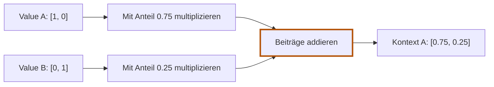

# 5.1 Informationen mischen

**Lernziel:** Aus zwei Vektoren und vorgegebenen Anteilen einen neuen Vektor berechnen.

## Anschluss: Vom Embedding zum Kontext

Das Embedding aus Kapitel 3 liefert einen Vektor pro Token und Position.
Noch enthält dieser Vektor keine Informationen über die anderen Tokens
im aktuellen Fenster. Wir wollen daraus einen neuen Vektor berechnen.

Auf dieser Seite betrachten wir nur das **Mischen**. Woher die Anteile
kommen, bleibt bis zur nächsten Seite offen. Rust und Burn brauchen wir
hier noch nicht.

## Unser Beispiel für diesen Lernpfad

Wir verwenden zwei künstliche Token-Vektoren:

```text
Token A: [1, 0]
Token B: [0, 1]
```

Diese Zahlen haben keine sprachliche Bedeutung. Sie sind so gewählt,
dass wir jeden Rechenschritt nachrechnen können. Zunächst verwenden wir
die Token-Vektoren unverändert als Inhalte, die wir weitergeben wollen.
Diese Inhaltsvektoren heissen **Values**:

```text
Value A = [1, 0]
Value B = [0, 1]
```

## Einen neuen Vektor für A berechnen

Nehmen wir vorläufig an, A soll 75 Prozent von Value A und 25 Prozent
von Value B übernehmen. Die Anteile geben wir hier vor:

```text
Kontext A = 0.75 * [1, 0] + 0.25 * [0, 1]
          = [0.75, 0] + [0, 0.25]
          = [0.75, 0.25]
```

Jede Zahl eines Values bekommt denselben Anteil. Danach addieren wir
die Zahlen an jeweils derselben Stelle. Das heisst **gewichtete Summe**.
Das Ergebnis nennen wir **Kontext-Vektor**.



A bekommt einen neuen Vektor, der Informationen beider Quellen enthält.
Die Token-ID, die Embedding-Tabelle und die ursprünglichen Values ändern
wir dabei nicht. Für B würden wir mit Bs eigenen Anteilen genauso rechnen.

## Selbst versuchen

B soll beide Values zu gleichen Teilen übernehmen. Welcher Kontext-Vektor
entsteht? Rechne erst selbst.

<details>
<summary>Lösung anzeigen</summary>

```text
Kontext B = 0.5 * [1, 0] + 0.5 * [0, 1] = [0.5, 0.5]
```

Zwei Quellen liefern Beiträge zu einem neuen Vektor. Der Kontext hat
weiterhin zwei Komponenten, nicht vier.

</details>

## Was bleibt?

**Anteile sagen, wie viel wir übernehmen. Values liefern den Inhalt.
Die gewichtete Summe ergibt den Kontext.**

Offen bleibt: Wer bestimmt die Anteile? Auf der nächsten Seite berechnen
wir sie aus Query und Keys.

Weiter: [5.2 Anteile berechnen](05-02-anteile-berechnen.md).

Zur Übersicht: [Kapitel 5](05-attention.md).
