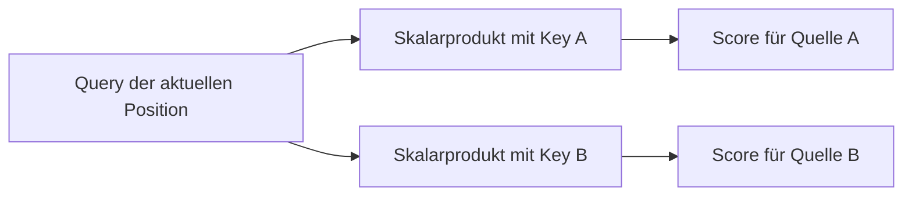
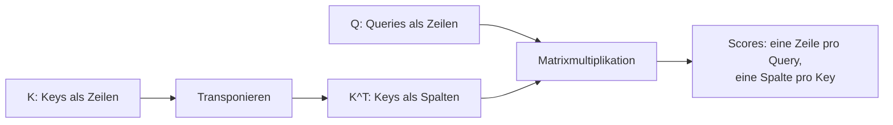
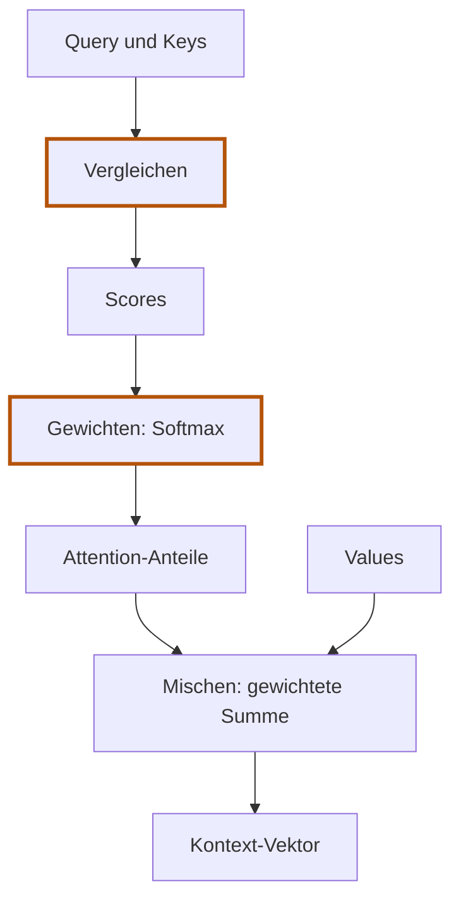

# 5.2 Anteile berechnen

**Lernziel:** Query und Key vergleichen und daraus Anteile für die Mischung berechnen.

## Anschluss: Die Anteile fehlen noch

In [5.1](05-01-informationen-mischen.md) haben wir Values mit vorgegebenen
Anteilen gemischt. Neu ist jetzt nur deren Herkunft: Jede Position berechnet
ihre eigenen Anteile. Die Mischung selbst bleibt unverändert.

Wir bleiben bei Token A `[1, 0]` und Token B `[0, 1]`.
Für diese erste Rechnung verwenden wir ihre Vektoren unverändert für
alle drei Rollen: `Q = K = V = X`. Woher unterschiedliche Vektoren später
kommen, behandeln wir erst in [5.4](05-04-projektionen.md).

## Warum Query, Key und Value?

Values liefern bereits den Inhalt. Jetzt brauchen wir zusätzlich einen
Vergleich: Welche Quellen passen aus Sicht der suchenden Position?
Query und Keys übernehmen diesen Vergleich. Es sind drei Rollen,
nicht drei verschiedene Arten von Tokens.

<details>
<summary>Verständnishilfe: Dokumente suchen</summary>

Stell dir eine Suche in einer Dokumentensammlung vor:

- **Query (Suchanfrage):** Du suchst eine Erklärung zur Tokenisierung.
- **Key (Suchmerkmal):** Jedes Dokument bietet Merkmale an, anhand derer du
  seine Eignung beurteilst, etwa Thema und Schlagwörter.
- **Value (Inhalt):** Aus einem passenden Dokument übernimmst du die eigentliche
  Erklärung, nicht nur seine Schlagwörter.

Suchanfrage und Suchmerkmale bestimmen also, **welches Dokument passt**.
Der Inhalt bestimmt, **was du daraus mitnimmst**.

Attention funktioniert ähnlich, aber ohne Textsuche oder fest eingetragene
Schlagwörter: Alle drei Rollen sind Zahlenvektoren. Statt ein Dokument hart
auszuwählen, berechnet Attention Gewichte und mischt die Inhalte mehrerer
Quellen.

</details>

### Jedes Token ist Suchender und Quelle

Bei **Self-Attention** stammen Query, Key und Value aus derselben Eingabesequenz.
Jede Token-Position bekommt alle drei Vektoren:

- Mit ihrer **Query** sucht sie Informationen für ihren eigenen neuen Vektor.
- Mit ihrem **Key** bietet sie anderen Positionen ein Vergleichssignal an.
- Mit ihrem **Value** liefert sie den Inhalt, den andere Positionen aufnehmen
  können.

Token A ist also nicht "die Query" und Token B nicht "der Key". A hat eine Query,
einen Key und einen Value; B ebenfalls.

Für As Kontext beginnen wir mit Query A, für Bs Kontext mit Query B.
Beide vergleichen sich mit denselben Keys und mischen dieselben Values,
können aber unterschiedliche Anteile erhalten.

## 1. Vergleichen: Scores

### Warum vergleichen wir?

Die Query beschreibt den Suchbedarf der aktuellen Position. Die Keys liefern
Vergleichssignale der möglichen Quellen. Wir vergleichen deshalb **eine Query
mit jedem Key**. Jeder Vergleich liefert eine Zahl, den Score:



Ein Score ist keine objektive Messung sprachlicher Bedeutung. Im lernbaren
Modell werden die Projektionen so angepasst, dass die daraus entstehenden
Vergleiche bei der Vorhersage helfen. Unsere festen Zahlen zeigen zunächst
nur die Rechenmechanik.

### Wie vergleichen wir?

**In den ersten beiden Vergleichen bleibt die Query gleich. Nur der Key
wechselt.** Wir betrachten zunächst nur die Sicht von Token A.

Unsere Ausgangswerte sind weiterhin:

```text
Token A: Query A = [1, 0]    Key A = [1, 0]
Token B: Query B = [0, 1]    Key B = [0, 1]
```

Die Query gehört zur suchenden Position, der Key zur jeweils betrachteten
Quelle. A vergleicht sich auch mit sich selbst: Die eigene Position ist
ebenfalls eine mögliche Quelle.

#### Vergleich 1: Query A mit Key A

Die Frage lautet: **Welchen Score bekommt Quelle A aus Sicht von A?**

```text
Query A: [1, 0]
Key A:   [1, 0]
```

Wir multiplizieren die Zahlen **an derselben Stelle** und addieren danach
die beiden Produkte. Diese Rechenregel heisst **Skalarprodukt**:

```text
Erste Stelle:  1 * 1 = 1
Zweite Stelle: 0 * 0 = 0
Summe:             1 + 0 = 1
```

Zwei Vektoren gehen hinein, eine Vergleichszahl kommt heraus.
Der Score für Quelle A aus Sicht von A ist also `1`.

#### Vergleich 2: Dieselbe Query A mit Key B

Jetzt lautet die Frage: **Welchen Score bekommt Quelle B aus Sicht von A?**
Wir behalten Query A und wechseln nur die Quelle:

```text
Query A: [1, 0]    <- unverändert
Key B:   [0, 1]    <- andere Quelle
```

Wieder verwenden wir dieselbe Rechenregel:

```text
Erste Stelle:  1 * 0 = 0
Zweite Stelle: 0 * 1 = 0
Summe:             0 + 0 = 0
```

Der Score für Quelle B aus Sicht von A ist `0`.
Damit ist As Vergleich mit allen Quellen fertig:

```text
Aus Sicht von A:
Quelle A -> Score 1
Quelle B -> Score 0
```

**Noch keine Prozente, noch kein Mischen.** Wir haben nur zwei
Vergleichszahlen berechnet. Erst Softmax macht daraus Anteile.
Score `0` bedeutet deshalb nicht, dass wir Quelle B schon ausgeschlossen haben.

#### Jetzt wechseln wir die suchende Position: Query B

Erst jetzt brauchen wir Query B. Für den Kontext von B wiederholen wir
denselben Ablauf **aus Sicht von Token B**. Query B bleibt dabei für beide
Vergleiche gleich; nacheinander verwenden wir Key A und Key B:

```text
Query B = [0, 1]

Query B mit Key A: 0 * 1 + 1 * 0 = 0
Query B mit Key B: 0 * 0 + 1 * 1 = 1
```

#### Alle vier Vergleiche zusammen

Damit haben wir vier Vergleiche: Jede der zwei Queries wird mit jedem der zwei
Keys verglichen. Zusammen ergeben sie eine Tabelle:

```text
          Key A  Key B
Query A     1      0
Query B     0      1
```

**Eine Zeile gehört zur suchenden Position, eine Spalte zur Quelle.**
As Zeile `[1, 0]` sagt: Score für Quelle A ist `1`, für Quelle B ist er `0`.

<details>
<summary>Vertiefung: Alle Vergleiche als Matrixmultiplikation</summary>

Eine rechteckige Zahlentabelle heisst Matrix. Statt die vier Skalarprodukte
einzeln aufzurufen, können wir sie als eine Matrixmultiplikation schreiben:

```text
scores = Q @ K^T
```

`@` bedeutet Matrixmultiplikation. `K^T` vertauscht Zeilen und Spalten, damit
jede Query gegen jeden Key gerechnet wird. Warum ist das Vertauschen nötig?
In `Q` stehen die Queries als Zeilen, in `K` zunächst auch die Keys.
Matrixmultiplikation vergleicht aber **Zeilen links mit Spalten rechts**.
Durch das Transponieren wird deshalb jede Key-Zeile zu einer Key-Spalte:



`Q @ K^T` ist somit die Kurzform für unsere vier Skalarprodukte, kein weiterer
inhaltlicher Rechenschritt. Bei unserer symmetrischen Eingabe sehen `K` und
`K^T` zufällig gleich aus; das Vertauschen ist hier optisch nicht erkennbar.

Die Score-Matrix hat die Form `[Token-Anzahl, Token-Anzahl]`. Eintrag `[i, j]`
vergleicht die Query von Token `i` mit dem Key von Token `j`. Eine Zeile gehört
also einer suchenden Position, eine Spalte einer möglichen Quelle. As Zeile
liest sich: "Mein Score für Quelle A ist 1, für Quelle B ist er 0."

</details>

Ein Score ist noch kein Anteil. Entscheidend sind seine Unterschiede zu den
anderen Scores derselben Query-Zeile, nicht seine absolute Grösse. Score `0`
bedeutet noch nicht "ignorieren", Score `1` nicht "100 Prozent übernehmen".
Erst im nächsten Schritt entstehen die Anteile.

## 2. Gewichten: Softmax

### Warum brauchen wir Gewichte?

Die Scores sagen, welche Quellen im Vergleich höher oder niedriger bewertet
werden. Sie können aber beliebige Zahlen sein, auch negative. Wir benötigen
jetzt eine Antwort auf eine andere Frage: **Wie viel übernehmen wir von jeder
Quelle?**

Softmax wandelt dafür die Scores in nichtnegative Anteile um, die pro Query
zusammen `1` ergeben. Für As Zeile:

```text
Scores [1, 0] -> Anteile ungefähr [0.731, 0.269]
```

Damit verwenden wir rund 73 Prozent des ersten und 27 Prozent des zweiten
Value-Vektors. "Prozent" ist eine Lesehilfe für die Mischung, keine
Wahrscheinlichkeit dafür, dass ein Token sprachlich richtig ist.

Warum wählen wir nicht nur die Quelle mit dem höchsten Score? Mehrere Quellen
können gleichzeitig hilfreich sein. Eine weiche Verteilung erlaubt eine
Mischung statt einer harten Ja-/Nein-Auswahl. Wie das späteres Lernen
ermöglicht, betrachten wir in [5.5](05-05-lernbare-parameter.md).

### Wie berechnet Softmax die Anteile?

Softmax wandelt jede Score-Zeile in Gewichte um:

```text
Gewicht j = exp(Score j) / Summe aller exp(Scores) dieser Zeile
```

<details>
<summary>Was macht exp(x), und woher kommt e?</summary>

`exp(x)` ist die **Exponentialfunktion**: Sie berechnet `e` hoch `x`.
`e` ist eine feste Zahl, ungefähr `2.71828`. Anders als beim Quadrieren
(`x * x`) ist hier also die Basis fest und der Score steht im Exponenten:

```text
exp(-1) = 1 / e     = ungefähr 0.368
exp(0)  = e hoch 0  = 1
exp(1)  = e hoch 1  = ungefähr 2.718
exp(2)  = e * e     = ungefähr 7.389
```

#### Woher kommt e = ungefähr 2.71828?

`e` ist keine frei gewählte Zahl, sondern eine mathematisch definierte
Konstante, ähnlich wie die Kreiszahl Pi. `2.71828` ist nur gerundet.

Ein Zugang ist Wachstum: Wir starten mit `1` und verteilen eine Wachstumsrate
von insgesamt 100 Prozent auf immer mehr Schritte. Jeder Schritt wirkt
auf den **bereits gewachsenen Wert**:

| Schritte | Rechnung | Ergebnis |
|---|---|---|
| Einmal 100 Prozent | `1 + 1` | `2` |
| Zweimal je 50 Prozent | `1.5 * 1.5` | `2.25` |
| Viermal je 25 Prozent | `1.25 hoch 4` | ungefähr `2.4414` |
| Hundertmal je 1 Prozent | `1.01 hoch 100` | ungefähr `2.7048` |

Allgemein berechnen wir bei `n` Schritten `(1 + 1/n) hoch n`.
Mit immer mehr, immer kleineren Schritten nähert sich das Ergebnis einer
festen Grenze. Diese Grenze definiert die Zahl
`e = 2.718281828...`. Die tatsächliche Zunahme ist dabei grösser als
100 Prozent, weil jeder Schritt auch das bisherige Wachstum mitvergrössert.

Für Attention genügt: **`exp` verwendet diese fest definierte Basis.
Wir wählen oder lernen `e` nicht.** Du musst ihre Herkunft nicht herleiten
können, um Softmax nachzurechnen.

</details>

Für Softmax sind zwei Eigenschaften wichtig: **Auch negative Scores werden
zu positiven Zahlen**, und **grössere Scores liefern grössere Ergebnisse**.
Ein Score von `0` wird zu `1`, nicht zu `0` – die Quelle wird also nicht
ausgeschlossen. Diese Ergebnisse sind noch keine Anteile. Erst das Teilen
durch ihre Summe macht daraus Gewichte, die zusammen `1` ergeben.

Für unsere erste Score-Zeile `[1, 0]` rechnen wir damit:

```text
exp(1) = 2.71828...
exp(0) = 1
Summe  = 3.71828...

Gewicht A = 2.71828... / 3.71828... = 0.73106...
Gewicht B = 1         / 3.71828... = 0.26894...
```

Damit ergeben sich:

```text
          Value A  Value B
Query A    0.731    0.269
Query B    0.269    0.731
```

Die Gewichte sind positiv und ergeben pro Zeile zusammen ungefähr `1`
(Rundungsfehler sind möglich). Gleiche Scores bekommen gleiche Gewichte.
Wir verwenden Burns `softmax`, statt die Exponentialfunktion selbst auszurechnen.

## Mischen: Die bekannten Values verwenden

Die Anteile ersetzen jetzt die vorgegebenen 75 und 25 Prozent aus 5.1.
Die Values bleiben A `[1, 0]` und B `[0, 1]`.

Für jede Query bilden wir eine gewichtete Summe der Values:

```text
Kontext A = 0.731... * [1, 0] + 0.269... * [0, 1]
          = [0.731..., 0.269...]

Kontext B = 0.269... * [1, 0] + 0.731... * [0, 1]
          = [0.269..., 0.731...]
```

Als Matrixmultiplikation:

```text
Kontext = weights @ V
```

Jedes Token bekommt damit einen neuen Vektor, der Informationen beider Tokens
enthält. Dass Kontext und Gewichte hier dieselben Zahlen haben, liegt an unseren
Values `[1, 0]` und `[0, 1]`. Mit anderen Values wäre das nicht so.

### Die drei Schritte gehören zusammen



**Vergleichen bestimmt die Passung. Gewichten bestimmt die Anteile.
Mischen überträgt die Inhalte.** Für jede Query entsteht so eine eigene
Zusammenfassung der erlaubten Quellen. In dieser ersten Demo sind noch alle
Positionen erlaubt; die spätere kausale Maske schränkt das ein.

## Selbst versuchen

Eine Query bekommt für beide Keys den Score `0`. Welche Anteile liefert
Softmax? Welcher Kontext entsteht mit unseren beiden Values?

<details>
<summary>Lösung anzeigen</summary>

`exp(0) = 1`, also bekommt jede Quelle `1 / (1 + 1) = 0.5`.
Der Kontext ist `0.5 * [1, 0] + 0.5 * [0, 1] = [0.5, 0.5]`.
Score `0` bedeutet also nicht Anteil `0`.

</details>

## Was bleibt?

**Query und Keys bestimmen Anteile. Values liefern Inhalte. Erst Mischen
erzeugt den Kontext.** Softmax allein würde noch keinen Inhaltsvektor liefern.

Wir können die erste Attention-Rechnung jetzt von Hand ausführen.
Als Nächstes suchen wir genau diese Schritte in einer kleinen Burn-Funktion.

Zurück: [5.1 Informationen mischen](05-01-informationen-mischen.md).
Weiter: [5.3 Erste Attention in Burn](05-03-erste-attention-in-burn.md).
