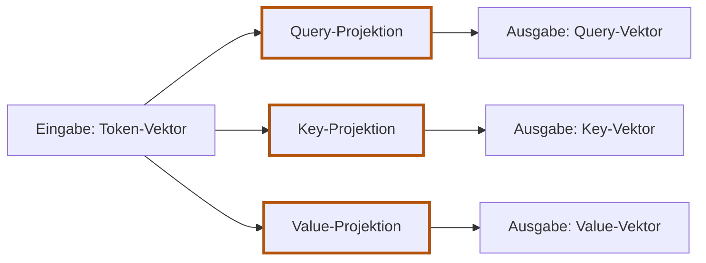
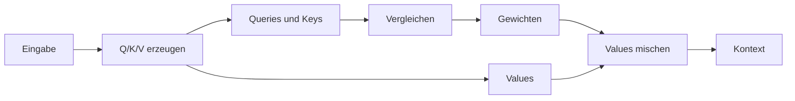

# 5.4 Query, Key und Value erzeugen

**Lernziel:** Eingabevektor, Projektion und deren Ausgabevektor unterscheiden.

## Anschluss: Bisher haben wir die Vektoren kopiert

In [5.3](05-03-erste-attention-in-burn.md) stand `Q = K = V = X`.
Jetzt ändern wir nur die Vorbereitung: Aus demselben Token-Vektor
entstehen drei eigene Vektoren. Vergleichen, Gewichten und Mischen bleiben.
Training und Skalierung sind noch nicht Teil dieser Seite.

## Was war bisher festgelegt?

In der ersten Demo haben wir denselben Eingabevektor unverändert für alle
drei Aufgaben verwendet:

```text
Token B, Eingabe: [0, 1]

Query B: [0, 1]
Key B:   [0, 1]
Value B: [0, 1]
```

So konnten wir Vergleichen, Gewichten und Mischen einzeln kennenlernen.
Aber das Modell kann damit noch nicht unabhängig bestimmen, wie es einen
Eingabevektor zum Suchen, zum Vergleichen und zum Weitergeben aufbereitet.

Jetzt ergänzen wir deshalb **vor dem Vergleichen** drei Umrechnungen:



Alle drei Projektionen erhalten denselben Token-Vektor als Eingabe. Jede
erzeugt einen eigenen Ausgabevektor: Query, Key beziehungsweise Value.
Diese drei Vektoren sind anschliessend die Eingaben der Attention-Rechnung,
nicht deren endgültiges Ergebnis. Das ist erst der Kontext-Vektor nach dem
Mischen der Values.

Die Eingabe selbst bleibt unverändert. Eine solche Umrechnung heisst hier
**Projektion**. Das Wort bedeutet in diesem Kapitel: Aus den Eingabezahlen
durch Multiplikation und Addition neue Zahlen berechnen. Die Ausgabe muss
dabei weder kleiner werden noch eine für Menschen lesbare Bedeutung haben.

## Erst eine Umrechnung, noch keine Matrix

Wir legen für die Query zunächst diese zwei Regeln fest:

```text
Erste Query-Zahl  = erste Eingabezahl + zweite Eingabezahl
Zweite Query-Zahl = zweite Eingabezahl
```

Wenden wir sie auf Token B an:

```text
Eingabe B: [0, 1]

Erste Query-Zahl:  0 + 1 = 1
Zweite Query-Zahl:     1 = 1

Query B: [1, 1]
```

Für Token A verwenden wir **dieselben Regeln**:

```text
Eingabe A: [1, 0]

Erste Query-Zahl:  1 + 0 = 1
Zweite Query-Zahl:     0 = 0

Query A: [1, 0]
```

Die Regeln unterscheiden sich also nicht je Token. Unterschiedliche
Eingabezahlen können trotzdem unterschiedliche Queries ergeben.

## Wo stecken die Gewichte?

Schreiben wir die Query-Regeln etwas ausführlicher:

```text
Erste Query-Zahl  = erste Eingabezahl * 1 + zweite Eingabezahl * 1
Zweite Query-Zahl = erste Eingabezahl * 0 + zweite Eingabezahl * 1
```

Die vier Faktoren `1`, `1`, `0`, `1` bestimmen die Umrechnung. Diese Faktoren
heissen **Projektionsgewichte**. Statt die Regeln als eigenen Programmcode
für jede Ausgabezahl zu schreiben, sammeln wir ihre Faktoren in einer Tabelle:

```text
                        Erste Query-Zahl   Zweite Query-Zahl
Erste Eingabezahl               1                  0
Zweite Eingabezahl              1                  1
```

Eine solche rechteckige Zahlentabelle heisst **Matrix**. Unsere Tabelle nennen
wir `W_Q`: `W` steht für die Gewichte, `Q` für die Query-Projektion.
In der Schreibweise des Codes sieht sie so aus:

```text
W_Q = [[1, 0],
       [1, 1]]
```

Jede innere Liste ist eine Zeile. Um eine Query-Zahl zu berechnen, nehmen wir
die Faktoren ihrer **Spalte**, multiplizieren sie mit den Eingabezahlen
und addieren. Für Token B `[0, 1]`:

```text
Spalte 0: [1, 1] -> erste Query-Zahl  = 0 * 1 + 1 * 1 = 1
Spalte 1: [0, 1] -> zweite Query-Zahl = 0 * 0 + 1 * 1 = 1
```

Das sind genau unsere beiden Regeln, nur als Tabelle gespeichert.
Die Kurzschreibweise **`Eingabe @ W_Q`** führt diese Multiplikationen und
Additionen für alle Ausgabespalten aus. Sie heisst Matrixmultiplikation.
Du musst dafür keine neue Rechenart lernen: Wir bündeln die bereits gezeigten
Einzelrechnungen.

## Key und Value bekommen andere Regeln

Warum andere Regeln? Nicht, weil für Keys das Tauschen und für Values das
Verdoppeln vorgeschrieben wäre. **Die konkreten Regeln wählen wir nur für
diese Demo**, damit wir unterschiedliche Rollen mit kleinen Zahlen
nachrechnen können. Das gilt auch für die Query-Regel aus dem vorherigen
Abschnitt.

Für den Key wählen wir eine andere Umrechnung: die zwei Eingabezahlen tauschen.
Für den Value verdoppeln wir die erste Zahl und verdreifachen die zweite:

```text
Key:
Erste Key-Zahl  = zweite Eingabezahl
Zweite Key-Zahl = erste Eingabezahl

Value:
Erste Value-Zahl  = erste Eingabezahl * 2
Zweite Value-Zahl = zweite Eingabezahl * 3
```

Auch diese Regeln lassen sich mit je vier Faktoren in einer Matrix speichern:

```text
W_K = [[0, 1],       W_V = [[2, 0],
       [1, 0]]              [0, 3]]
```

Rechnen wir wieder nur Token B `[0, 1]` durch:

```text
Erste Key-Zahl:    0 * 0 + 1 * 1 = 1
Zweite Key-Zahl:   0 * 1 + 1 * 0 = 0
Key B: [1, 0]

Erste Value-Zahl:  0 * 2 + 1 * 0 = 0
Zweite Value-Zahl: 0 * 0 + 1 * 3 = 3
Value B: [0, 3]
```

Aus **einem** Eingabevektor `[0, 1]` haben wir somit drei verschiedene
Vektoren erzeugt: Query `[1, 1]`, Key `[1, 0]` und Value `[0, 3]`.
Es sind weiterhin drei Rollen derselben Token-Position, keine neuen Tokens.

## Warum drei getrennte Umrechnungen?

Wir wollen drei Aufgaben getrennt anpassen können:

- Die Query-Projektion bestimmt, welche Merkmale eine Position beim Suchen
  verwendet.
- Die Key-Projektion bestimmt, welche Merkmale eine Position zum Vergleich
  anbietet.
- Die Value-Projektion bestimmt, welche Informationen eine Position weitergibt.

Würden alle drei dieselbe Gewichtsmatrix verwenden, würde eine Änderung dieser
Matrix gleichzeitig Suchfragen, Vergleichssignale und Inhalte verändern.
Mit drei getrennten Matrizen kann das Training beispielsweise die
Vergleichssignale anpassen, ohne dabei zwangsläufig die Values zu verändern.
Bei gleicher Eingabe bleiben die anderen Projektionen dann unverändert.

Die Regeln **müssen nicht zwingend unterschiedlich sein**. Getrennte Matrizen
geben dem Modell die Möglichkeit, unterschiedliche Umrechnungen zu lernen.
Es gibt keine Vorschrift, wie stark sie sich unterscheiden sollen. Für unsere
Demo haben wir unterschiedliche Zahlen bewusst gewählt, um diese Möglichkeit
sichtbar zu machen.

Für beide Tokens zusammen erhalten wir:

```text
             Eingabe    Query     Key       Value
Token A      [1, 0]     [1, 0]    [0, 1]    [2, 0]
Token B      [0, 1]     [1, 1]    [1, 0]    [0, 3]
```

**Bis hier haben wir noch keine Nachbarinformationen aufgenommen.** Jede
Projektion verarbeitet die Eingabe eines Tokens für sich. Erst die folgenden
Query-Key-Vergleiche verbinden verschiedene Positionen; beim Mischen werden
ihre Inhalte übernommen. Die Reihenfolge ist:



<details>
<summary>Vertiefung: Die Grössen der Tabellen benennen</summary>

Jetzt können wir auch die Namen im Code zuordnen:

- `embedding_dim`: Anzahl der Zahlen im Eingabevektor, hier `2`.
- `head_dim`: Anzahl der Zahlen im erzeugten Query-, Key- oder Value-Vektor,
  in unserem Baustein ebenfalls `2`.

Eine Projektionsmatrix hat eine Zeile pro Eingabezahl und eine Spalte pro
Ausgabezahl. Ihre Form ist deshalb `[embedding_dim, head_dim]`, hier `[2, 2]`.
Hätten wir vier Eingabezahlen und wollten zwei Ausgabezahlen, bräuchten wir
vier Zeilen und zwei Spalten. Die Rechenregel bleibt dieselbe.

</details>

## Selbst versuchen

Berechne für A `[1, 0]` mit den Regeln dieser Seite Key und Value.
Entstehen dadurch neue Token-Positionen?

<details>
<summary>Lösung anzeigen</summary>

Key tauscht die Zahlen: `[0, 1]`. Value verdoppelt die erste und
verdreifacht die zweite: `[2, 0]`. Die Query ist wie oben `[1, 0]`.
Es bleibt dieselbe Position A, jetzt mit drei Vektoren für drei Aufgaben.
Noch wurde kein Value mit dem eines Nachbartokens gemischt.

</details>

## Was bleibt?

**Ein Token-Vektor wird dreimal umgerechnet. Query, Key und Value sind
Ausgaben der Projektionen und Eingaben der Attention-Rechnung.**
Die Faktoren dieser Umrechnungen stehen in `W_Q`, `W_K` und `W_V`.
Alle Positionen verwenden dieselben drei Matrizen.

Die Faktoren waren bisher von uns gewählt. Warum sie dennoch
„lernbar“ heissen, klären wir auf der nächsten Seite.

Zurück: [5.3 Erste Attention in Burn](05-03-erste-attention-in-burn.md).
Weiter: [5.5 Was daran lernbar ist](05-05-lernbare-parameter.md).
