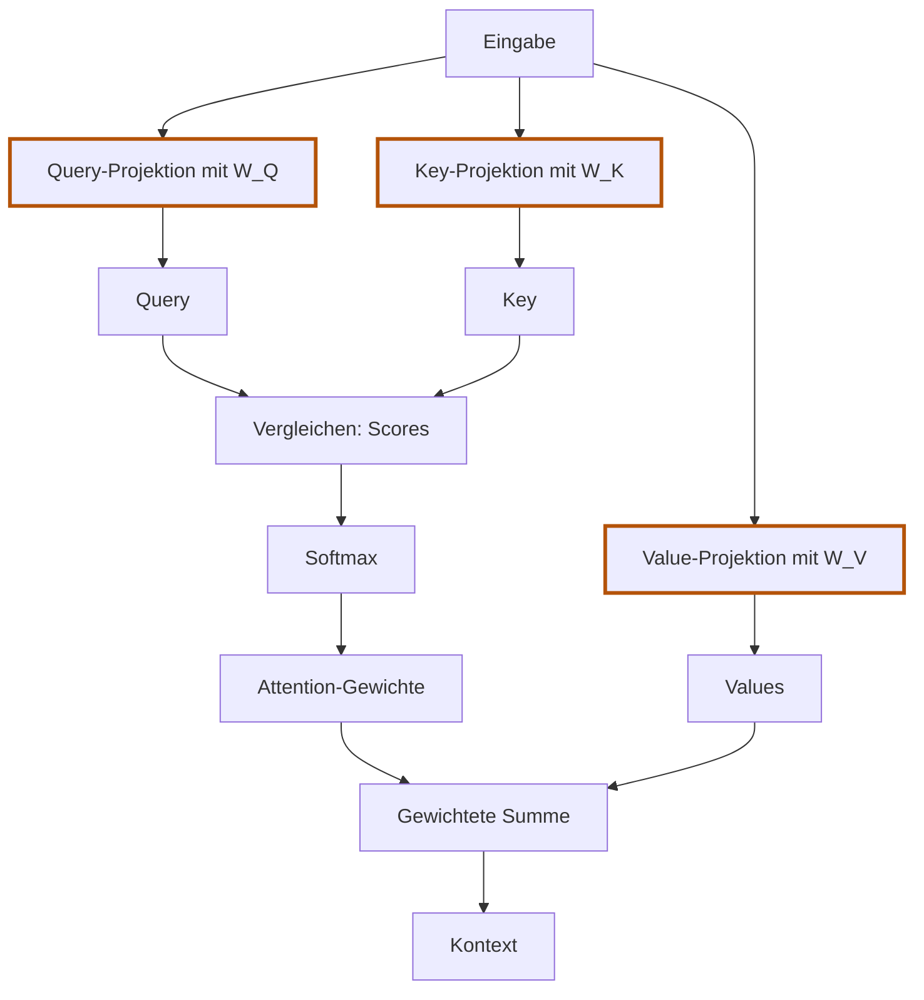

# 5.5 Was daran lernbar ist

**Lernziel:** Modellparameter von berechneten Attention-Anteilen unterscheiden.

## Anschluss: Umrechnen ist noch kein Lernen

In [5.4](05-04-projektionen.md) haben wir feste Rechenregeln benutzt.
Neu ist jetzt die Frage: Welche Zahlen darf ein späteres Training verändern?
Die Rechenreihenfolge bleibt unverändert. Einen Optimizer implementieren wir
hier noch nicht.

## Warum heisst das "lernbar"?

Unsere drei Umrechnungsregeln sind keine Vorgaben dafür, wie Sprache
funktioniert. Ihre Faktoren sind bewusst einfache Beispielzahlen.
Im normalen Modell initialisiert Burn diese Zahlen zufällig.

Dabei müssen wir zwei Entscheidungen auseinanderhalten:

**Die Rechenform legen wir als Entwickler fest.** In unserem Baustein soll
jede Projektion eine Matrixmultiplikation sein:

```text
Query = Eingabe @ W_Q
Key   = Eingabe @ W_K
Value = Eingabe @ W_V
```

Wir wählen auch die Grössen der Matrizen. Diese Rechenform und die Grössen
ändern sich beim Training unseres Bausteins nicht.

**Die Zahlen in den Matrizen sind die anpassbaren Parameter.** Sie bestimmen,
welche konkrete Umrechnung die festgelegte Rechenform ausführt. In der Demo
geben wir sie vor. Im normalen Modell beginnt Burn mit zufälligen Werten.
Diese Startwerte sind noch keine sinnvoll gelernten Such- oder Vergleichsregeln.

Wie werden daraus nützliche Umrechnungen? Im späteren Training läuft wiederholt
dieser Ablauf:

<details>
<summary>Vertiefung: Woher die Rückmeldung beim Training kommt</summary>

1. Das Modell verarbeitet Text und sagt nächste Tokens vorher. Dabei verwendet
   es auch seine aktuellen Query-, Key- und Value-Projektionen.
2. Eine Verlustfunktion bewertet, wie gut die Vorhersagen zu den tatsächlichen
   nächsten Tokens passen.
3. Burn berechnet Gradienten, auch für die Zahlen in `W_Q`, `W_K` und `W_V`.
   Sie zeigen, wie kleine Parameteränderungen den Verlust beeinflussen.
4. Ein Optimizer verändert die Parameter anhand dieser Gradienten, um den
   Verlust zu verringern. Nicht jeder einzelne Schritt muss die Vorhersagen
   verbessern.

Wir schreiben dabei keine Suchfragen wie "Finde das Verb" in die Matrizen.
Die Rückmeldung kommt aus der Vorhersageaufgabe. Über viele Trainingsschritte
können dadurch Umrechnungen entstehen, die für diese Aufgabe hilfreich sind.
Ihre einzelnen Zahlen müssen für uns keine leicht benennbare Bedeutung haben.

</details>

Im späteren Training verändert ein Optimizer die Zahlen in den Matrizen
mithilfe ihrer Gradienten. Dadurch verändert sich die Umrechnungsregel, ohne
dass wir den Programmcode ändern. Ein einzelnes Beispiel:

```text
Bisherige erste Query-Spalte: [1, 1]
Andere erste Query-Spalte:    [1, 2]

Für dieselbe Eingabe B [0, 1]:
Bisherige erste Query-Zahl = 0 * 1 + 1 * 1 = 1
Andere erste Query-Zahl    = 0 * 1 + 1 * 2 = 2
```

Eine geänderte Zahl in `W_Q` erzeugt also eine andere Query. Damit können
sich später Scores, Attention-Anteile und Kontext ändern. Entsprechend
verändert `W_K` die Keys und `W_V` die weitergegebenen Inhalte.

**Lernbar** bedeutet: Diese Zahlen sind Modellparameter, deren Gradienten
Burn berechnen kann und die ein Optimizer verändern kann. **Gelernt** sind
sie erst nach solchen Trainingsschritten. Unsere Demo verändert noch nichts
durch Training.

## Zwei verschiedene Bedeutungen von "Gewichten"

Hier kann die Sprache verwirren. Wir verwenden zwei unterschiedliche Arten
von Gewichten:

- **Projektionsgewichte** sind die Zahlen in `W_Q`, `W_K` und `W_V`.
  Sie gehören zum Modell und bleiben bei einem normalen `forward` unverändert.
- **Attention-Gewichte** sind die Anteile, die Softmax aus den Scores berechnet.
  Sie entstehen für die jeweilige Eingabe neu und bestimmen, wie die Values
  gemischt werden.

Dass wir beide "Gewichte" nennen, macht sie nicht zum selben Gegenstand.
Projektionsgewichte erzeugen Vektoren; Attention-Gewichte verteilen Anteile
auf Quellen. Im Code heisst die Matrix einer Projektion `weight`, die
berechnete Attention-Verteilung dagegen `weights`.

Der Datenfluss hilft, die Aufgaben auseinanderzuhalten:



Ein Pfeil bedeutet: Der nächste Schritt verwendet das vorherige Ergebnis.
**Der Value-Weg führt nicht durch die Score-Berechnung.** Er trifft erst beim
Mischen mit den Attention-Gewichten zusammen.

Softmax ist differenzierbar: Burns Autograd aus Kapitel 4 kann durch die
Anteile zu den Query- und Key-Parametern zurückrechnen. Die Values und ihre
Parameter hängen über die gewichtete Summe ebenfalls am Rechenweg.
Auf [5.8](05-08-attention-kopf-in-burn.md) prüfen wir solche Gradienten.

## Selbst versuchen

Wir ändern nur `W_V`, lassen Eingabe, `W_Q` und `W_K` gleich.
Ändern sich die Attention-Anteile? Kann sich der Kontext trotzdem ändern?

<details>
<summary>Lösung anzeigen</summary>

Die Anteile bleiben gleich: Query, Keys und Scores sind unverändert.
Die Values können sich aber ändern. Dieselben Anteile mischen dann andere
Inhalte und können dadurch einen anderen Kontext ergeben.

</details>

## Was bleibt?

**Projektionsgewichte gehören zum Modell. Attention-Anteile werden für
die jeweilige Eingabe berechnet.** `forward` benutzt die Parameter;
erst ein Optimizer verändert sie. Lernbar bedeutet noch nicht gelernt.

Bevor wir den vollständigen Baustein schreiben, ergänzen wir zwei
Rechenschritte. Zuerst verändern wir die Scores durch Skalierung.

Zurück: [5.4 Query, Key und Value erzeugen](05-04-projektionen.md).
Weiter: [5.6 Scores skalieren](05-06-scores-skalieren.md).
