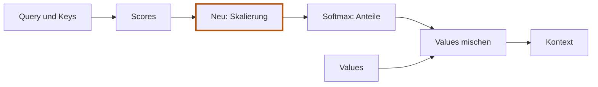

# 5.6 Scores skalieren

**Lernziel:** Den zusätzlichen Teiler vor Softmax einsetzen und seine Wirkung erklären.

## Anschluss: Ein zusätzlicher Schritt

Wir kennen jetzt die drei Projektionen und ihre Parameter.
Neu ist **nur die Skalierung der Scores vor Softmax**. Query, Key, Value,
Softmax und das Mischen bleiben wie bisher. Es findet kein Training statt.



## Warum die Scores skalieren?

Bisher haben wir die Scores direkt an Softmax übergeben. Jetzt ergänzen wir
den hervorgehobenen Zwischenschritt: die **Skalierung**.
Dabei teilen wir die Scores durch die Quadratwurzel der Query-/Key-Breite.
Es entsteht also keine weitere Art von Gewichten; wir verändern die Scores,
bevor Softmax daraus Attention-Gewichte berechnet. Warum brauchen wir das?

Ein Skalarprodukt addiert für jede Vektorkomponente ein Produkt. Bei breiteren
Query-/Key-Vektoren kommen mehr Summanden zusammen. Dadurch können die Scores
stärker streuen, obwohl die einzelnen Komponenten ähnlich gross bleiben.

Softmax reagiert auf grosse Unterschiede mit sehr ungleichen Gewichten.
Ein Beispiel:

```text
softmax([1, 0])  = ungefähr [0.731, 0.269]
softmax([10, 0]) = ungefähr [0.99995, 0.00005]
```

Wenn ein Gewicht fast `1` ist und alle anderen fast `0`, reagiert Softmax nur
noch schwach auf kleine Score-Änderungen. Das kann das Lernen erschweren.
Deshalb teilen wir **vor Softmax** durch die Quadratwurzel der Query-/Key-Breite:

```text
scaled_scores = (Q @ K^T) / sqrt(head_dim)
```

Die Quadratwurzel einer Zahl ist die positive Zahl, die mit sich selbst
multipliziert wieder die Ausgangszahl ergibt. Zum Beispiel ist `sqrt(4) = 2`,
weil `2 * 2 = 4`. Für unsere Breite `2` ist `sqrt(2)` ungefähr `1.414`.

Wir ändern dabei nicht, welcher Score grösser ist. Wir verkleinern die
Unterschiede, bevor Softmax daraus Gewichte bildet. In unserem Beispiel wird
aus `[0, 1]` ungefähr `[0, 0.707]`: Der zweite Eintrag bleibt grösser, bekommt
aber ein weniger stark dominierendes Gewicht.

**Für den Rechenweg genügt:** Die Query-/Key-Breite liefert den Teiler.
Skalierung kommt vor Softmax und verhindert, dass die Vektorbreite allein
die Gewichte unnötig zuspitzt. Sie garantiert keine kleinen Scores und keine
gleichmässigen Gewichte; das hängt auch von den Projektionen ab.

Die statistische Begründung für die Quadratwurzel ist optional:
[Warum Attention durch die Quadratwurzel teilt](../exkurse/attention-skalierung.md).

## Den neuen Kontext nachrechnen

Jetzt verbinden wir die bisherigen Schritte zu einer vollständigen
Handrechnung. Wir verwenden weiterhin dieselben beiden Tokens. Die
Projektionen haben bereits diese Vektoren erzeugt:

```text
          Query     Key       Value
Token A   [1, 0]    [0, 1]    [2, 0]
Token B   [1, 1]    [1, 0]    [0, 3]
```

Unser Ziel ist **ein neuer Kontext-Vektor für A und einer für B**.
Wir berechnen zunächst As Anteile und mischen damit die Values. Danach
wiederholen wir denselben Ablauf für B. Die Projektionen selbst ändern wir
dabei nicht; es findet kein Training statt.

Die Ergebnisse des Rechenwegs sind:

```text
                 A                     B
Scores           [0, 1]                [1, 1]
Skalierte Scores [0, 0.707...]          [0.707..., 0.707...]
Anteile          [0.330238...,          [0.5, 0.5]
                  0.669762...]
Kontext          [0.660477...,          [1, 1.5]
                  2.009285...]
```

Nur die Score-Zeilen werden durch den neuen Faktor geteilt.
Wenn dir ein Ergebnis unklar ist, öffne die vollständige Rechnung:

<details>
<summary>Handrechnung Schritt für Schritt</summary>

### 1. Jede Query mit beiden Keys vergleichen

Für A rechnen wir:

```text
Query A mit Key A: 1 * 0 + 0 * 1 = 0
Query A mit Key B: 1 * 1 + 0 * 0 = 1
```

As unskalierte Score-Zeile ist also `[0, 1]`. Für B:

```text
Query B mit Key A: 1 * 0 + 1 * 1 = 1
Query B mit Key B: 1 * 1 + 1 * 0 = 1
```

Bs Score-Zeile ist `[1, 1]`. Zusammen:

```text
             Key A [0, 1]   Key B [1, 0]
Query A [1, 0]     0              1
Query B [1, 1]     1              1
```

Die erste Zeile gehört zu A, die zweite zu B. Innerhalb jeder Zeile steht
zuerst der Vergleich mit Quelle A, dann der mit Quelle B.

### 2. Alle Scores durch denselben Faktor teilen

Query und Key enthalten jeweils zwei Zahlen. Deshalb ist `head_dim = 2`,
und wir teilen jeden Score durch `sqrt(2)`, ungefähr `1.414`:

```text
Für A: [0 / sqrt(2), 1 / sqrt(2)] = ungefähr [0.000, 0.707]
Für B: [1 / sqrt(2), 1 / sqrt(2)] = ungefähr [0.707, 0.707]
```

Das ist die Skalierung, noch nicht die Umwandlung in Anteile.
A bewertet Quelle B weiterhin höher; bei B bleiben beide Scores gleich.

### 3. Für jede Query eigene Attention-Anteile berechnen

Softmax verarbeitet As Zeile getrennt von Bs Zeile. Für A berechnen wir
zuerst die Exponentialwerte:

```text
Quelle A: exp(0)           = 1
Quelle B: exp(1 / sqrt(2)) = ungefähr 2.02811
Summe                     = ungefähr 3.02811

Anteil für Quelle A = 1       / 3.02811... = ungefähr 0.330238
Anteil für Quelle B = 2.02811... / 3.02811... = ungefähr 0.669762
```

Die Anteile ergeben zusammen `1`. A übernimmt also ungefähr 33 Prozent von
Value A und 67 Prozent von Value B.

Bei B sind beide skalierten Scores gleich. Deshalb sind auch ihre
Exponentialwerte gleich:

```text
Quelle A: exp(1 / sqrt(2)) = ungefähr 2.02811
Quelle B: exp(1 / sqrt(2)) = ungefähr 2.02811
Summe                     = ungefähr 4.05623

Anteil für Quelle A = 0.5
Anteil für Quelle B = 0.5
```

Bs Anteile sind also jeweils 50 Prozent. Die beiden Zeilen der
Attention-Gewichte lauten:

```text
           Anteil Quelle A   Anteil Quelle B
Für A          0.330238...        0.669762...
Für B          0.5                0.5
```

### 4. Die Values mit diesen Anteilen mischen

Jetzt mischen wir **die projizierten Values**, nicht die Eingabevektoren:

```text
Value A = [2, 0]
Value B = [0, 3]
```

Für As Kontext erhält jede Zahl von Value A den Faktor `0.330238...`;
jede Zahl von Value B erhält den Faktor `0.669762...`. Anschliessend
addieren wir die Beiträge an der jeweils gleichen Stelle:

```text
Erste Kontext-Zahl für A:
0.330238... * 2 + 0.669762... * 0 = 0.660477...

Zweite Kontext-Zahl für A:
0.330238... * 0 + 0.669762... * 3 = 2.009285...

Kontext A = [0.660477..., 2.009285...]
```

Für B verwenden wir dieselben Values, aber Bs eigene Anteile:

```text
Erste Kontext-Zahl für B:  0.5 * 2 + 0.5 * 0 = 1
Zweite Kontext-Zahl für B: 0.5 * 0 + 0.5 * 3 = 1.5

Kontext B = [1, 1.5]
```

</details>

### Was hat sich gegenüber der Eingabe verändert?

```text
          Eingabe    Neuer Kontext
Token A   [1, 0]     [0.660477..., 2.009285...]
Token B   [0, 1]     [1, 1.5]
```

Die Anzahl der Positionen bleibt zwei. Jede Position hat aber einen neuen
Vektor, der Beiträge beider Values enthält. Beide Positionsausgaben verwenden
dieselben Quellen, gewichten sie jedoch unterschiedlich.

Dabei hat keine Zahl automatisch eine benennbare sprachliche Bedeutung.
Wir haben nur gezeigt, wie getrennte Projektionen, Vergleich, Skalierung,
Softmax und Mischung rechnerisch zusammenwirken.

In der Handrechnung solltest du die ungerundeten Anteile weiterverwenden:
Mit `0.670 * 3` bekämst du `2.010` statt gerundet `2.009`.
Das ist kein anderer Rechenweg, sondern ein Rundungsunterschied.
Die spätere Burn-Demo auf 5.8 verwendet zusätzlich eine Maske und liefert
deshalb für A ein anderes Ergebnis. Hier rechnen wir noch **ohne Maske**.

## Selbst versuchen

Wir teilen alle Scores wie in unserer Rechnung durch `sqrt(2)`.
Kann dadurch ein bisher kleinerer Score zum grösseren werden?
Müssen die Softmax-Anteile trotzdem gleich bleiben?

<details>
<summary>Lösung anzeigen</summary>

Die Reihenfolge bleibt erhalten. In As Zeile wird aus `[0, 1]`
ungefähr `[0, 0.707]`: Der zweite Score bleibt grösser.
Die Softmax-Anteile ändern sich aber, weil die Unterschiede kleiner werden.
Die Verteilung wird weniger zugespitzt.

</details>

<details>
<summary>Zusatzübung: Nur den Inhalt verändern</summary>

Wir lassen Eingabe, `W_Q` und `W_K` unverändert. Nur die Value-Matrix ersetzen
wir gedanklich:

```text
Bisher: W_V = [[2, 0],     Neu: W_V = [[4, 0],
               [0, 3]]                 [0, 6]]
```

Was verändert sich an Anteilen und Kontext? Versuche erst selbst,
den Rechenweg aus [5.5](05-05-lernbare-parameter.md) wiederzufinden.

<details>
<summary>Lösung anzeigen</summary>

1. Query und Key verwenden weiterhin dieselben Eingaben und Matrizen.
   Ihre Vektoren bleiben gleich.
2. Deshalb bleiben auch Scores, skalierte Scores und Attention-Gewichte gleich.
   Für A verwenden wir weiterhin ungefähr `[0.330, 0.670]`.
3. Die neue Value-Matrix liefert dagegen Value A `[4, 0]` und Value B `[0, 6]`.
4. Mit denselben Anteilen mischen wir nun andere Inhalte:

```text
Neuer Kontext A = 0.330238... * [4, 0] + 0.669762... * [0, 6]
                = [1.320954..., 4.018569...]

Neuer Kontext B = 0.5 * [4, 0] + 0.5 * [0, 6]
                = [2, 3]
```

Hier haben wir alle Value-Zahlen verdoppelt, also verdoppelt sich auch der
Kontext. Die Auswahlanteile ändern sich nicht. Allgemein kann eine Änderung
von `W_V` den Kontext verändern; nicht jede denkbare Änderung muss bei jeder
Eingabe sichtbar werden.

**Zum Mitdenken:** Wenn du nur `W_K` änderst, welchen Weg betrifft das?
Es ist der Vergleichsweg: Keys und damit möglicherweise Scores und
Attention-Gewichte ändern sich. Die Values bleiben gleich, können aber mit
anderen Anteilen gemischt werden. Auch dadurch kann sich der Kontext ändern.

</details>

</details>

## Was bleibt?

**Skalierung teilt Scores vor Softmax; sie erzeugt weder neue Parameter
noch neue Values.** Nach der Skalierung kommen dieselben Schritte wie zuvor.

Offen ist noch, welche Quellen ein Token überhaupt verwenden darf.
A verwendet bisher auch B – für ein GPT-Modell wäre das Zukunft.

Zurück: [5.5 Was daran lernbar ist](05-05-lernbare-parameter.md).
Weiter: [5.7 Zukunft ausblenden](05-07-zukunft-ausblenden.md).
