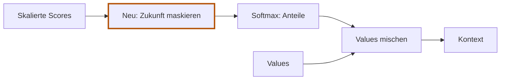

# 5.7 Zukunft ausblenden

**Lernziel:** Zukunftspositionen vor Softmax ausschliessen und den neuen Kontext berechnen.

## Anschluss: Bisher waren alle Quellen erlaubt

In [5.6](05-06-scores-skalieren.md) konnte A Informationen von B aufnehmen.
Für GPT an Position 0 wäre B aber Zukunft.
Neu ist **nur die Maske zwischen Skalierung und Softmax**.
Projektionen und Skalierung bleiben unverändert; die Anteile werden danach
mit den erlaubten Quellen neu berechnet.



## Das Problem: Der Blick in die Zukunft

In unseren bisherigen Rechnungen berechnet Token A (`[1, 0]`) seine Attention
auch über Token B (`[0, 1]`). Die Reihenfolge ist:

```text
Position 0: Token A
Position 1: Token B
```

Im autoregressiven Sprachmodell (wie GPT) ist die Aufgabe: **Vorhersage des
nächsten Tokens**. Wenn Position 0 bereits Informationen von Position 1
aufnehmen darf, "sieht" das Modell die Zukunft. Beim echten Erzeugen
von Text existiert Position 1 aber noch gar nicht!

Das Modell würde lernen, auf zukünftige Wörter zu schauen, statt aus dem
bisherigen Kontext das nächste Wort vorherzusagen.

*(Hinweis: Modelle wie **BERT** arbeiten anders: Sie generieren keinen Text,
sondern füllen Lücken im Satz und dürfen deshalb in beide Richtungen schauen.
Den genauen Unterschied beleuchtet der Exkurs
[BERT vs. GPT: Bidirektionale vs. kausale Attention](../exkurse/bert-vs-gpt.md).)*

<span id="die-lösung-vor-softmax-auf--infty-setzen"></span>

## Die Lösung: Vor Softmax auf minus unendlich setzen

**−∞ bedeutet minus unendlich**, im Code `-inf`. Das ist kein gewöhnlicher
negativer Zahlenwert. Wir verwenden ihn als Markierung für ausgeschlossene
Quellen: `exp(-inf)` ergibt `0`, also erhalten diese Quellen nach Softmax
keinen Anteil.

Wir müssen verhindern, dass Position `i` Informationen von Positionen `j > i`
erhält. Können wir die unerlaubten Gewichte nicht einfach nach dem Softmax auf 0
setzen?

Nein: Softmax normalisiert die Zeile so, dass die Summe aller Anteile exakt 1
ergibt. Wenn wir danach Werte auf 0 setzen, stimmt die Summe nicht mehr:

```text
Gewichte vor Nullsetzen:  [0.33, 0.67]  Summe: 1.0
Nach Nullsetzen von B:    [0.33, 0.00]  Summe: nur noch 0.33!
```

Die verbleibenden Quellen müssten wieder auf 100 % hochskaliert werden.
Viel eleganter und mathematisch sauber ist es, das **vor dem Softmax** zu tun:

Erinnerung an Softmax:

```text
Gewicht j = exp(Score j) / Summe aller exp(Scores) dieser Zeile
```

Was macht die Exponentialfunktion `exp(x)` mit verschiedenen Werten?

```text
exp(0)   = 1.0
exp(1)   = ungefähr 2.718
exp(-10) = ungefähr 0.000045
exp(-inf) = 0.0
```

Wenn ein Score vor dem Softmax minus unendlich (`-inf`) ist, wird sein
Zählerterm exakt `0.0`. Dadurch erhält jede Zukunftsposition **automatisch
genau 0 % Aufmerksamkeit**, und die Summe der erlaubten Positionen bleibt
bis auf Gleitkomma-Rundung `1`.

## Die Maske als Matrix

Für eine Sequenz der Länge 2 sieht die Erlaubnis so aus:

```text
                 Quelle 0    Quelle 1
Suchender 0:     erlaubt     ZUKUNFT (-inf)
Suchender 1:     erlaubt     erlaubt
```

Für drei Tokens:

```text
                 Quelle 0    Quelle 1    Quelle 2
Suchender 0:     erlaubt     -inf        -inf
Suchender 1:     erlaubt     erlaubt     -inf
Suchender 2:     erlaubt     erlaubt     erlaubt
```

Die erlaubten Einträge bilden ein Dreieck unten links (untere Dreiecksmatrix).
Jede Position `i` darf nur Quellen `j <= i` sehen.

## Die Handrechnung mit Maske

Nehmen wir die skalierten Scores aus [5.6](05-06-scores-skalieren.md):

```text
            Quelle 0  Quelle 1
Query 0:      0.000     0.707
Query 1:      0.707     0.707
```

Jetzt wenden wir die Maske an. Score `[0, 1]` (Query 0 gegen Quelle 1) ist
Zukunft und wird durch `-inf` ersetzt:

```text
Maskierte Scores:
            Quelle 0  Quelle 1
Query 0:      0.000     -inf
Query 1:      0.707     0.707
```

### Softmax für Query 0 (Position 0)

```text
Quelle 0: exp(0)    = 1.0
Quelle 1: exp(-inf) = 0.0
Summe               = 1.0 + 0.0 = 1.0

Anteil Quelle 0 = 1.0 / 1.0 = 1.0  (100 %)
Anteil Quelle 1 = 0.0 / 1.0 = 0.0  (0 %)
```

Ohne Maske waren es noch `[0.330, 0.670]`. Durch die Maske konzentriert sich
Position 0 zu 100 % auf sich selbst!

### Softmax für Query 1 (Position 1)

Position 1 darf beide Quellen sehen. Hier ändert sich nichts:

```text
Anteil Quelle 0 = 0.5 (50 %)
Anteil Quelle 1 = 0.5 (50 %)
```

Die maskierten Attention-Gewichte lauten:

```text
           Anteil Quelle 0   Anteil Quelle 1
Query 0          1.0               0.0
Query 1          0.5               0.5
```

## Neuer Kontext mit Maske

Unsere Value-Vektoren waren:

```text
Value 0 = [2, 0]
Value 1 = [0, 3]
```

**Kontext für Position 0:**

```text
1.0 * [2, 0] + 0.0 * [0, 3] = [2, 0]
```

Position 0 gibt exakt ihren eigenen Value-Vektor weiter. Sie erfährt rein gar
nichts von Position 1.

**Kontext für Position 1:**

```text
0.5 * [2, 0] + 0.5 * [0, 3] = [1, 1.5]
```

Position 1 kombiniert Vergangenheit und Gegenwart zu gleichen Teilen.

## Selbst versuchen

Wir ändern nur den Eingabevektor von B. Darf dadurch der Kontext von A
anders werden? Begründe mit der Maske, nicht mit den konkreten Zahlen.

<details>
<summary>Lösung anzeigen</summary>

Nein. A darf nur Quelle A verwenden. Die Projektionen von A hängen nur
von As Eingabe ab; Bs Score wird maskiert, Bs Anteil bleibt `0`.
Der Kontext von B darf sich dagegen ändern. Die Modellparameter bleiben
bei diesem Vergleich unverändert.

</details>

## Was bleibt?

**Maskierung schliesst Quellen aus, bevor Softmax Anteile berechnet.**
Für jede Position bleiben sie selbst und ihre Vergangenheit erlaubt.
Values und Projektionen ändern wir durch die Maske nicht.

Die vollständige Mathematik eines kausalen Kopfes ist jetzt bekannt.
Auf der nächsten Seite bauen wir genau diesen Ablauf als Burn-Modell.

Zurück: [5.6 Scores skalieren](05-06-scores-skalieren.md).
Weiter: [5.8 Einen Attention-Kopf in Burn bauen](05-08-attention-kopf-in-burn.md).
