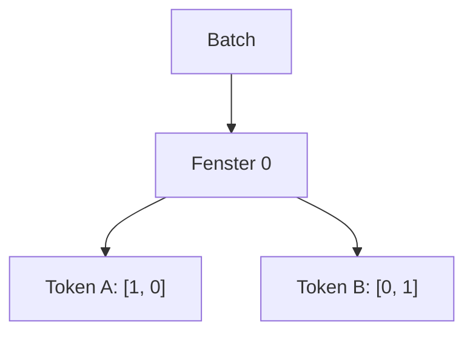
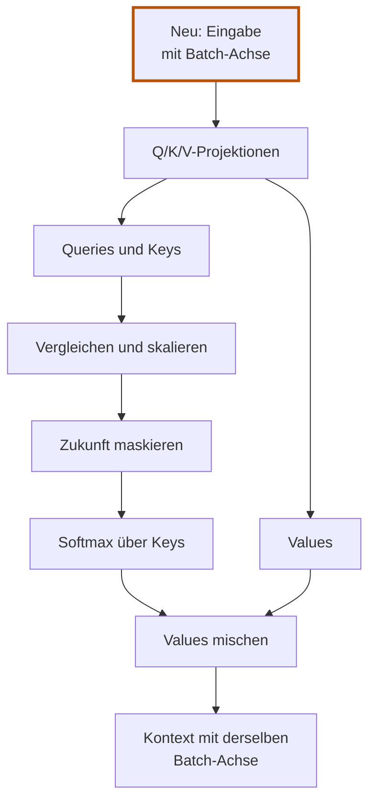

# 5.8 Einen Attention-Kopf in Burn bauen

**Lernziel:** Die vollständige Rechnung im Modell und in den Tensorformen wiederfinden.

## Anschluss: Alle Rechenschritte sind bekannt

Bis [5.7](05-07-zukunft-ausblenden.md) haben wir Projektionen, Skalierung
und Maske von Hand ergänzt. Jetzt übertragen wir genau diese Rechnung auf
einen Burn-Baustein. Neu sind nur **Modellverwaltung und die Batch-Achse**.

Unsere feste Eingabe bleibt A `[1, 0]`, B `[0, 1]`.
Mit Maske erwarten wir Kontext A `[2, 0]` und Kontext B `[1, 1.5]`.
Die frühere unmaskierte Ausgabe `[0.660477..., 2.009285...]` für A
aus 5.6 ist hier ausdrücklich nicht mehr das erwartete Ergebnis.

Diese Seite hat fünf Stationen:

1. [Modell aufbauen](#modell-aufbauen): Welche Werte speichert der Baustein?
2. [Eingabe verstehen](#eingabe-verstehen): Wie sind Fenster und Tokens gruppiert?
3. [Berechnung verfolgen](#berechnung-verfolgen): Wie setzt `forward` die
   Handrechnung um?
4. [Demo ausführen](#demo-ausführen): Wie setzen wir unsere festen Beispielzahlen?
5. [Lernbarkeit prüfen](#lernbarkeit-prüfen): Können Gradienten zurückfliessen?

Lies zuerst den Aufbau, dann die Eingabeform und anschliessend `forward`.
Die Übungen stehen jeweils nach der vollständigen Erklärung, nicht mitten
im Rechenweg. Rust-Begriffe erklären wir getrennt von den Rechenoperationen.

## Modell aufbauen

Der Baustein liegt in `crates/model/src/attention.rs`. Er hat zwei Teile:
Die Config beschreibt die Grössen; das Modell speichert die drei Projektionen.

```rust,ignore
{{#include ../../../crates/model/src/attention.rs:config}}
```

`Linear` ist Burns lernbare lineare Projektion. Wir verwenden drei getrennte
Instanzen, jede mit eigener Gewichtsmatrix. Das `Module`-Derive macht ihre
Parameter für Burn zugänglich. Das Backend wählen wir über das Device:
`Device::flex()` für die Demo, mit `.autodiff()` für Gradienten.

<details>
<summary>Vertiefung: Drei Schichten initialisieren</summary>

Ein `impl`-Block enthält Funktionen, die zu einem Typ gehören. Hier gehören
`new` und `init` zur Config `SelfAttentionConfig`. `new` speichert die
gewünschten Grössen; `init` erzeugt daraus die drei Schichten:

```rust,ignore
{{#include ../../../crates/model/src/attention.rs:config_impl}}
```

Beide Funktionen stehen innerhalb derselben äusseren geschweiften Klammern
von `impl SelfAttentionConfig`. `new` gibt mit `Self` eine Config zurück,
`init` dagegen ein Modell vom Typ `SelfAttention`.

`with_bias(false)` lässt einen zusätzlichen lernbaren Summanden weg. So bleibt
die Berechnung genau `X @ W` und passt zur Handrechnung. Dafür schreiben wir
keine eigene Matrixmultiplikation oder Parameterverwaltung.

</details>

<details>
<summary>Vertiefung: Rust und Burn beim Modellaufbau lesen</summary>

Eine `struct` bündelt zusammengehörige Werte. Unsere Config enthält nur zwei
Grössen: `embedding_dim` und `head_dim`. `usize` ist Rusts Ganzzahltyp für
Grössen und Indizes. Das Modell selbst enthält dagegen drei `Linear`-Schichten,
die jeweils eine Gewichtsmatrix und die dazugehörige Berechnung verwalten.
`pub` macht diese Felder öffentlich; so kann die Demo die Gewichte ersetzen.

`SelfAttention` ist nicht fest auf einen Backend-Typ beschränkt.
Seit Burn 0.22 gibt es dafür keinen Typparameter `B` mehr.
Die Demo übergibt ein `Device::flex()`: CPU-Berechnung mit standardmässig
32-Bit-Gleitkommazahlen. Die Tensoren tragen ihre Device-Zuordnung zur Laufzeit.

`#[derive(Module, Debug)]` bittet Rust und Burn, Hilfscode zu erzeugen.
`Module` ermöglicht die Verwaltung der enthaltenen Modellparameter; `Debug`
ermöglicht eine Debug-Darstellung. Diesen erzeugten Code musst du nicht selbst
schreiben oder für die Attention-Rechnung nachvollziehen.

Das Modell hat einen eigenen `impl`-Block für `SelfAttention`. Darin steht
`forward`, das die eigentliche Rechnung ausführt. Diesen Block betrachten wir
vollständig unter [Berechnung verfolgen](#berechnung-verfolgen).
Die Trennung ist wichtig: **Initialisieren erzeugt Parameter; `forward`
verwendet sie, ohne sie zu trainieren.**

In `init` ist `device: &Device` ein ausgeliehenes Gerät der gewählten
Rechenumgebung. `&` bedeutet hier, dass wir das Gerät verwenden, ohne es zu
übernehmen. Burns `LinearConfig` beschreibt eine einzelne Projektion.
Wir rufen ihr `init` dreimal auf: gleiche Grössen, aber drei getrennte
Schichten und Gewichtsmatrizen.

Für die ersten Durchgänge reicht es, `Module`, `Device` und die Initialisierung
als Burn-Bausteine einzuordnen. Den Datenfluss in `forward` solltest du dagegen
Schritt für Schritt verfolgen können. Weitere Rust-Grundlagen stehen im Exkurs
[Rust-Grundlagen für das Embedding](../exkurse/rust-grundlagen-embedding.md);
die Framework-Rollen erklärt [Burn: Die Bausteine](../exkurse/burn-grundlagen.md).

</details>

## Eingabe verstehen

### Vom einzelnen Fenster zum Batch

Ein **Tensor** ist hier eine Sammlung von Zahlen mit einer Form. Bisher war die
Form `[2, 2]`: zwei Token-Zeilen mit je zwei Zahlen. Für mehrere unabhängige
Textfenster brauchen wir eine zusätzliche äussere Gruppierung, den **Batch**.

Unsere neue Demo verwendet genau ein Fenster. Stell es dir so vor:



Die Linien zeigen hier die Gruppierung, keinen Rechenablauf.

In verschachtelten Listen stehen dieselben Zahlen:

```text
[
    [             <- Fenster 0
        [1, 0],   <- Token A
        [0, 1]    <- Token B
    ]
]
```

Die Kommentare mit Pfeilen gehören nur zur Darstellung, nicht zum Rust-Code.
Die Form ist `[1, 2, 2]`: **ein Fenster, zwei Tokens pro Fenster, zwei Zahlen
pro Token**. Wir haben keine zusätzlichen Token-Eigenschaften erfunden; nur
die Gruppierung um eine Ebene erweitert.

Jede Stelle in der Form gehört zu einer **Achse**. Die Achsen zählen ab `0`:

```text
Achse 0: Welches Fenster?          Grösse 1
Achse 1: Welche Token-Position?    Grösse 2
Achse 2: Welche Zahl im Vektor?    Grösse 2
```

"Dreidimensional" bedeutet hier **drei Achsen**, nicht drei Zahlen pro Token.
Die Vektorbreite ist die Grösse der letzten Achse. Zwei Fenster mit jeweils
zwei Tokens und Vektorbreite zwei hätten die Form `[2, 2, 2]` und insgesamt
`2 * 2 * 2 = 8` Zahlen.

Das Embedding liefert genau diese Gruppierung. Unser Attention-Kopf übernimmt
deshalb die Form `[Batch, Sequenzlänge, embedding_dim]`.

### Eine Form lesen

Bei einer **Eingabe** ist unsere feste Vereinbarung:

```text
Form:         [Batch, Tokens pro Fenster, Zahlen pro Token]
Beispiel:     [    2,                  3,                4]
```

Wie viele Fenster, Token-Vektoren und einzelne Zahlen beschreibt diese Form?

<details>
<summary>Lösung anzeigen</summary>

Lies die Form von links nach rechts. Wir haben zwei Fenster. Öffnen wir eines,
finden wir darin drei Token-Vektoren. Öffnen wir einen Token-Vektor, finden wir
vier Zahlen:

```text
Fenster 0: Token 0 [_, _, _, _]
           Token 1 [_, _, _, _]
           Token 2 [_, _, _, _]

Fenster 1: Token 0 [_, _, _, _]
           Token 1 [_, _, _, _]
           Token 2 [_, _, _, _]
```

Die Unterstriche sind Platzhalter, keine Werte. Insgesamt sind es
`2 * 3 * 4 = 24` Zahlen. Mehr Fenster vergrössern den Batch, nicht die
Vektoren der einzelnen Tokens.

**Zum Mitdenken:** Was wäre bei `[1, 3, 4]` anders?
Nur die Zahl der Fenster: eines statt zwei. Pro Fenster bleiben drei Tokens
mit jeweils vier Zahlen.

Die Form allein nennt keine Bedeutung. `[2, 3, 4]` könnte in einem anderen
Programm etwa zwei Bilder mit drei Zeilen und vier Spalten beschreiben.
Erst die Vereinbarung unseres Modells sagt, welche Achse wofür steht.

</details>

## Berechnung verfolgen

Zuerst betrachten wir die Formen des gesamten Rechenwegs. Danach lesen wir
`forward` in derselben Reihenfolge: prüfen, projizieren, vergleichen und
skalieren, maskieren, gewichten, mischen.

### Die Formen im Überblick

Der Rechenweg hat diese Formen:

```text
Eingabe             [Batch, Sequenzlänge, embedding_dim]
Q, K, V             [Batch, Sequenzlänge, head_dim]
K mit Tausch        [Batch, head_dim, Sequenzlänge]
Scores und Gewichte [Batch, Sequenzlänge, Sequenzlänge]
Kontext             [Batch, Sequenzlänge, head_dim]
```

Wie in [5.4: Was bedeutet head_dim?](05-04-projektionen.md#was-bedeutet-head_dim)
erklärt, darf `head_dim` von `embedding_dim` abweichen: Die Projektionen
legen die Ausgabebreite fest. Ohne Ausgabeprojektion bleibt
die Ausgabe dann entsprechend breiter oder schmaler als die Eingabe.



```rust,ignore
{{#include ../../../crates/model/src/attention.rs:model_impl}}
```

### Eingabe prüfen

<details>
<summary>Vertiefung: Signatur, Destrukturierung und Assertions</summary>

Die Signatur `forward(&self, input: Tensor<3>) -> Tensor<3>` sagt:
Wir leihen das Modell mit `&self` aus, übernehmen einen Eingabetensor und liefern
einen Ausgabetensor zurück. Die `3` ist die Anzahl der Achsen, nicht deren
Grösse. Welche konkreten Grössen der Tensor hat, liefert `dims()`.

`let [batch_size, context_length, embedding_dim] = input.dims();` verteilt diese
drei Grössen auf verständliche Namen. Dieses Zerlegen eines Arrays heisst
*Destrukturierung*. Die folgende Zeile liest die beiden Grössen der Query-Matrix:
Eingabebreite und Head-Breite.

Die Assertions prüfen zuerst, ob die Eingabe zum Modell passt. `assert!`
verlangt eine wahre Bedingung, `assert_eq!` zwei gleiche Werte. Ist eine
Bedingung verletzt, bricht die Berechnung mit der angegebenen Meldung ab.
Diese Zeilen sind Formprüfungen, nicht Teil der Attention-Mathematik.

</details>

### Query, Key und Value erzeugen

Die nächsten drei Zeilen berechnen unabhängig voneinander:

```text
query = Eingabe @ Query-Gewichte
key   = Eingabe @ Key-Gewichte
value = Eingabe @ Value-Gewichte
```

`input.clone()` erhält die Eingabe für die weiteren Projektionen.
Das ist dieselbe Rust-Eigenschaft wie in 5.3, kein neuer Attention-Schritt.
Eine Ownership-Übung steht unten als Vertiefung.

### Vergleichen, skalieren und maskieren

`key.swap_dims(1, 2)` tauscht für jedes Fenster die Token- und Vektorachse.
Aus `[Batch, Tokens, Head-Breite]` wird `[Batch, Head-Breite, Tokens]`.
So kann `matmul` jede Query gegen jeden Key vergleichen. Für unser Fenster:

```text
Query      [1, 2, 2]
Key-Tausch [1, 2, 2]
Scores     [1, 2, 2]
```

Die Grössen sehen hier zufällig identisch aus, die Achsenbedeutung aber nicht.
Bei drei Tokens und Head-Breite zwei wären sie `[1, 3, 2]`, `[1, 2, 3]`
und `[1, 3, 3]`: Query-Komponenten treffen auf Key-Komponenten.

`(head_dim as f64).sqrt()` liefert den Skalierungsfaktor. `as f64` wandelt die
Ganzzahlbreite in eine Gleitkommazahl um; `.sqrt()` berechnet deren Quadratwurzel.
Durch diesen Faktor teilen wir sämtliche Scores.

Danach folgt die Maske aus 5.7: `mask_fill(mask, f32::NEG_INFINITY)`
ersetzt Zukunftsscores durch `-inf`. Den Aufbau der Maske kannst du unten
in der Vertiefung nachlesen.

Die Batch-Achse bleibt bei diesen Operationen unverändert. `matmul` rechnet
jedes Fenster separat; Fenster tauschen keine Informationen aus.

### Attention-Anteile berechnen

Nach dem Vergleich hat sich die Bedeutung der letzten Achse geändert:
In `scores` steht sie für **Key-Positionen**, nicht mehr für Vektorkomponenten.
Deshalb bedeutet `softmax(scores, 2)`: Gewichte entlang der Key-Positionen
berechnen, für jede Query und jedes Fenster separat.

### Values mischen und Kontext zurückgeben

Die letzte Zeile `weights.matmul(value)` mischt die Value-Vektoren. In Rust
wird ein letzter Ausdruck ohne Semikolon zum Rückgabewert der Funktion.
Für drei Tokens mit Head-Breite zwei ist die Formrechnung:

```text
Gewichte [1, 3, 3] @ Values [1, 3, 2] -> Kontext [1, 3, 2]
```

Die Kontextausgabe enthält wieder einen Vektor pro Token. Die Zahl der
Value-Komponenten bestimmt seine Breite.

<details>
<summary>Vertiefung: Drei Verwendungen derselben Eingabe in Rust</summary>

Der Rechenweg ist jetzt vollständig. Betrachte zur Vertiefung zuerst Rusts
Ownership, nicht die Mathematik:

```text
Vor Query: input verfügbar
Query bekommt einen Clone -> input weiterhin verfügbar
Key bekommt einen Clone   -> input weiterhin verfügbar
Value bekommt input       -> input danach nicht mehr verwendbar
```

Diese Reihenfolge erklärt die Clones vollständig. Value erhält das Original
nicht, weil es mathematisch wichtiger wäre, sondern weil es **im Code zuletzt**
auf die Eingabe zugreift.

**Zum Mitdenken:** Würden wir zuerst Value, dann Key, zuletzt Query berechnen,
wer könnte dann das Original bekommen?
Query. Value und Key bräuchten Clones, damit Query die Eingabe noch erhält.
Die Attention-Mathematik wäre dieselbe. Entscheidend ist die letzte Verwendung,
nicht der Rollenname. Diese Frage betrifft Rust-Ownership, nicht Attention.

</details>

### Angeleitete Übung: Für wen sollen Gewichte zusammen 1 ergeben?

Diese zweite Übung betrifft die Attention-Rechnung. Nach der Score-Berechnung
lesen wir die Achsen so:

```text
scores[Fenster, Query-Position, Key-Position]
       Achse 0   Achse 1        Achse 2
```

Fixiere gedanklich Fenster 0 und Query A. Übrig bleibt eine Liste der Scores
gegen die Quellen A und B:

```text
                    Quelle A   Quelle B
Query A, Scores       0.000      -inf
Query A, Gewichte     1.000      0.000    Summe: 1
```

Welche Achse muss Softmax normalisieren? Warum ist ihre Nummer anders
als in der ersten Demo?

<details>
<summary>Lösung anzeigen</summary>

Wir wollen wissen, wie **diese eine Query** ihren Anteil auf alle Quellen
verteilt. Deshalb normalisiert Softmax entlang der Quelle-Liste, also der
Key-Achse `2`. Für Query B berechnet es unabhängig eine weitere Verteilung.

Über Achse `1` würden wir stattdessen für eine feste Quelle die verschiedenen
Queries normalisieren. Das beantwortet eine andere Frage und liefert nicht
die gewünschten Anteile pro suchender Position. Über Achse `0` würden wir
verschiedene Fenster zur Normalisierung heranziehen.

**Zum Mitdenken:** Warum stand in der ersten Demo `softmax(..., 1)`?
Dort gab es keinen Batch. Die Form war `[Query-Position, Key-Position]`:
Query auf Achse `0`, Key auf Achse `1`. Normalisiert wird in beiden Demos
über **Keys**; nur ihre Achsennummer unterscheidet sich.

</details>

## Demo ausführen

### Feste Projektionsgewichte einsetzen

Wir ersetzen die zufälligen Startwerte durch unsere drei Matrizen:

```rust,ignore
{{#include ../../../crates/model/examples/ch05_projections.rs:fixed}}
```

`Param::from_tensor` verpackt einen Tensor als Modellparameter. Die festen
Zahlen dienen nur der nachvollziehbaren Demo, nicht als sinnvolle Startwerte
für ein Sprachmodell.

<details>
<summary>Vertiefung: Die Zuweisungen in Rust lesen</summary>

Lies die erste Zuweisung von innen nach aussen: `Tensor::from_data` erstellt
aus `QUERY_WEIGHTS` eine Burn-Zahlentabelle auf unserem Gerät.
`Param::from_tensor` kennzeichnet sie als Modellparameter.
`attention.query.weight = ...` ersetzt damit die bisherige Query-Matrix.
`let mut attention` erlaubt diese Änderung am Modellwert; ohne `mut` wäre
die Zuweisung in Rust nicht erlaubt. Key und Value werden genauso ersetzt.

</details>

```bash
cargo run -p model --example ch05_projections
```

Ausgabe:

```text
{{#include ../ausgaben/ch05_projections.txt}}
```

Die erste Demo bleibt unverändert: Mit `ch05` kannst du weiter die Grundrechnung
ohne Projektion und Skalierung betrachten.

Die neue Demo verwendet dagegen **Projektionen, Skalierung und Maske**.
Vergleiche mit [5.7](05-07-zukunft-ausblenden.md): A liefert `[2, 0]`,
B liefert `[1, 1.5]`. Dass A nicht die unmaskierte Ausgabe aus 5.6 liefert,
ist beabsichtigt.

## Lernbarkeit prüfen

<details>
<summary>Vertiefung: Gradienten und weitere Modelltests</summary>

Wir haben jetzt das Modell aufgebaut, seine Berechnung verfolgt und die
Demo betrachtet. Zuletzt prüfen wir, was an diesem Baustein "trainierbar" ist.
Die Tests berechnen Gradienten, verändern aber noch keine Parameter.

Die Integrationstests in `crates/model/tests/attention.rs` verwenden denselben
Baustein auch mit `Device::flex().autodiff()`. Wie in Kapitel 4 summieren sie die
Ausgabe und rufen `backward()` auf. Sie prüfen endliche, nicht durchweg null
gesetzte Gradienten für alle drei Projektionsmatrizen und die markierte Eingabe.
Softmax und Matrixmultiplikationen bleiben Teil von Burns Rechengraph.

Weitere Tests vergleichen das Ergebnis mit der Handrechnung, prüfen getrennte
Batches, ein Fenster mit nur einem Token und den Anschluss an das vorhandene
Embedding mit unterschiedlicher Head-Breite.

```bash
cargo test -p model --test attention
```

Die Summe ist wieder nur ein Lernbeispiel, keine geeignete Verlustfunktion für
Sprachvorhersagen. Ein Optimizer verändert noch keine Gewichte. Modellberechnung
bleibt im Modell-Crate; die spätere Trainingslogik gehört in das Training-Crate.

</details>

<details>
<summary>Vertiefung: Maskenaufbau und Kausalitätstest</summary>

## Kausale Maskierung in Rust mit Burn

Wie sieht diese Maskierung im echten Code von `crates/model/src/attention.rs` aus?

```rust,ignore
{{#include ../../../crates/model/src/attention.rs:causal_mask}}
```

Die Zeilen im Detail:

1. **`if context_length > 1`**: Bei einem einzelnen Token (`context_length == 1`)
   gibt es keine Zukunft. Die Maskierung kann übersprungen werden.
2. **`Tensor::<2>::ones([context_length, context_length], ...)`**: Erzeugt
   eine quadratische 2D-Matrix aus Einsen.
3. **`.triu(1)`** (*upper triangular*): Behält nur Werte **oberhalb** der
   Hauptdiagonale (Offset 1) und setzt Diagonale sowie untere Werte auf 0.
   Das sind genau die verbotenen Zukunftspositionen.
4. **`.bool()`**: Wandelt die Matrix in Wahrheitswerte (`true` für Zukunft,
   `false` für Gegenwart und Vergangenheit).
5. **`.unsqueeze()`**: Fügt die Batch-Dimension hinzu, damit die Form `[1, context_length, context_length]`
   zum 3D-Score-Tensor passt (Broadcasting über alle Batches).
6. **`scores.mask_fill(mask, f32::NEG_INFINITY)`**: Ersetzt alle `true`-Stellen
   durch $-\infty$.

## Kausalität mit einem Test beweisen

Um sicherzugehen, dass frühere Tokens nicht durch spätere Tokens beeinflusst
werden, testen wir das Verhalten in `crates/model/tests/attention.rs`:

```rust,ignore
{{#include ../../../crates/model/tests/attention.rs:test_causal}}
```

Die Idee des Tests:
Wir übergeben zwei Sequenzen an `forward`.
- Sequenz A hat 2 Tokens.
- Sequenz B hat dieselben 2 Tokens und zusätzlich ein drittes Token mit extremen
  Zahlenwerten (`[99.0, -99.0]`).

Dank der kausalen Maskierung müssen die Ausgaben für Token 0 und Token 1 in beiden
Fällen **exakt identisch** sein.

```bash
cargo test -p model --test attention future_tokens_do_not_influence_earlier_outputs
```

</details>

## Selbst versuchen

Das Embedding liefert `[2, 3, 4]`: zwei Fenster mit je drei Tokens
und vier Zahlen pro Token. Der Kopf hat `head_dim = 2`.
Welche Formen haben Q/K/V, Scores und Kontext? Tauschen die Fenster
Informationen aus?

<details>
<summary>Lösung anzeigen</summary>

```text
Q, K, V: [2, 3, 2]
Scores:  [2, 3, 3]
Kontext: [2, 3, 2]
```

Die beiden Fenster werden unabhängig verarbeitet.
Die beiden Achsen der Länge `3` bei den Scores haben verschiedene Rollen:
Query-Position und Key-Position. Die letzte `2` im Kontext ist dagegen
die Zahl der Value-Komponenten.

</details>

## Was bleibt?

**Ein Burn-Modell speichert Parameter und führt unsere bekannte Rechnung
pro Fenster aus.** Batch, Position und Vektorkomponente sind verschiedene
Achsen. Softmax normalisiert immer über Keys, nicht über eine fest
auswendig gelernte Achsennummer.

Ein Kopf berechnet eine Mischung pro Token. Jetzt kombinieren wir mehrere
solcher Mischungen zu Multi-Head Attention.

Zurück: [5.7 Zukunft ausblenden](05-07-zukunft-ausblenden.md).
Weiter: [5.9 Mehrere Köpfe verbinden](05-09-mehrere-koepfe.md).
