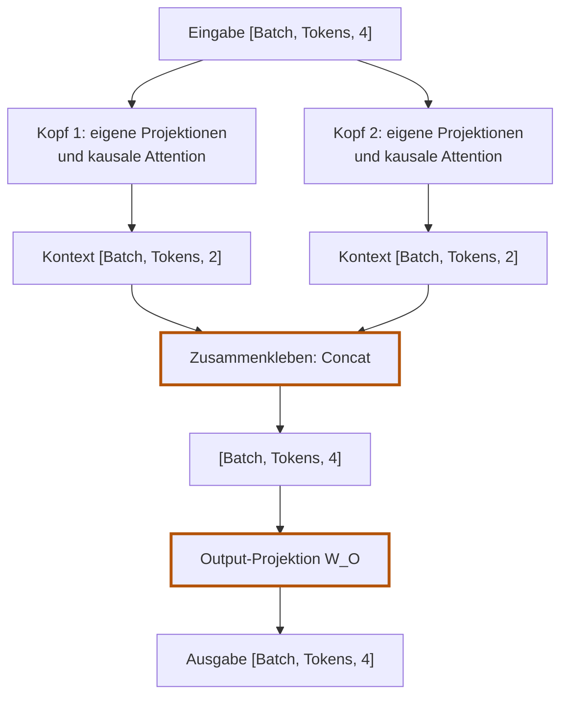

# 5.9 Mehrere Köpfe verbinden

**Lernziel:** Die Kontext-Vektoren mehrerer Köpfe pro Token zusammenfügen
und gemeinsam projizieren. Verstehen, wie einzelne Köpfe und gemeinsame
4D-Tensoroperationen dieselbe Rechnung unterschiedlich organisieren.

## Anschluss: Ein Kopf funktioniert bereits

In [5.8](05-08-attention-kopf-in-burn.md) haben wir einen vollständigen
kausalen Attention-Kopf (Attention Head) gebaut. Jetzt verwenden wir mehrere
davon unabhängig voneinander: Das ist Multi-Head Attention.
„Parallel“ beschreibt hier zunächst unabhängige Rechenwege. Ob sie
tatsächlich gleichzeitig ausgeführt werden, hängt vom Backend und der
Hardware ab.
Jeder Kopf führt dieselben Schritte wie bisher aus: Er projiziert die Eingabe
zu Query, Key und Value, vergleicht Queries mit Keys, skaliert und maskiert die
Scores, berechnet mit Softmax die Gewichte und mischt damit die Values.

Für zwei Köpfe mit Kopfbreite (Head Dimension, `head_dim`) 2 erweitern wir
die Eingabebreite jetzt bewusst von 2 auf 4. Diese Einbettungsbreite heisst
Embedding Dimension (`embedding_dim`). Das folgende Zahlenbeispiel beginnt bei den fertigen
Kopf-Ausgaben; es ist keine Fortsetzung der konkreten Zahlen aus 5.8.

## Warum mehrere Mischungen?

Ein Kopf liefert pro Query eine Verteilung über die erlaubten Quellen.
Er kann dabei bereits mehrere Quellen mischen, aber nur mit dieser einen
Verteilung. Mehrere Köpfe berechnen mehrere Verteilungen mit eigenen
Projektionen. So können sie unterschiedliche Informationen hervorheben.

Wir geben nicht vor, dass Kopf 1 Grammatik und Kopf 2 Bedeutung lernen soll.
Solche Spezialisierungen sind möglich, aber weder fest eingebaut noch
garantiert. Neu ist die Möglichkeit, **mehrere Mischungen parallel** zu lernen.

## Das Prinzip: Aufteilen, parallel rechnen, zusammenführen

1. **Breiten festlegen:** Wir verteilen die Ausgabebreite der Projektionen
   auf die Köpfe: hier Breite 4 auf zwei Köpfe mit je Breite 2.
   **Jeder Kopf erhält trotzdem den vollständigen Eingabevektor der Breite 4**,
   nicht nur eine Hälfte davon.
2. **Parallele Attention:** Jeder Kopf rechnet unabhängig seine eigene
   kausale Attention (mit eigenen Matrizen `W_Q`, `W_K` und `W_V`).
3. **Zusammenkleben (Concatenation, kurz Concat):** Die Teilergebnisse beider Köpfe werden
   hintereinandergehängt. Aus zweimal Breite 2 wird wieder die volle Breite 4.
4. **Mischen (Output Projection, `W_O`):** Eine abschließende lineare Schicht
   vermischt die Erkenntnisse aller Köpfe miteinander.



## Die Handrechnung für 2 Köpfe

Betrachten wir zwei Tokens (Position 0 und 1) mit Einbettungsbreite
(`embedding_dim`) 4:

### 1. Mit vorgegebenen Kopf-Ausgaben beginnen

Die folgenden Werte sind für das Beispiel vorgegeben, nicht hier aus
Query, Key und Value hergeleitet. Diese Rechnung kennen wir bereits
aus den vorherigen Seiten. Neu sind jetzt das Zusammenfügen der
Kopf-Ausgaben (Concat) und die anschliessende Output-Projektion.

Jeder Kopf erzeugt für jedes Token einen Kontext-Vektor (Context Vector)
der Kopfbreite (`head_dim`) 2:

**Kopf 1** liefert:
- Token 0: `[2.0, 0.0]`
- Token 1: `[1.0, 1.5]`

**Kopf 2** liefert:
- Token 0: `[0.0, 1.0]`
- Token 1: `[2.0, 0.5]`

### 2. Zusammenkleben (Concat)

Wir hängen die Vektoren pro Token einfach nebeneinander:

```text
Token 0:
Concat(Kopf 1 [2.0, 0.0], Kopf 2 [0.0, 1.0]) = [2.0, 0.0, 0.0, 1.0]

Token 1:
Concat(Kopf 1 [1.0, 1.5], Kopf 2 [2.0, 0.5]) = [1.0, 1.5, 2.0, 0.5]
```

Form vorher je Kopf: `[1, 2, 2]`.
Form nach Concat: `[1, 2, 4]`. Die Dimension 4 ist wieder hergestellt.

Der längere Vektor enthält damit beide Sichtweisen auf Token 0. **Keine Zahl geht verloren; keine wird addiert.** Token 1 bekommt separat seinen eigenen zusammengefügten Vektor.

### 3. Warum Concat allein noch nicht mischt

Nach dem Concat liegen die Zahlen nur nebeneinander im selben Array:
- Platz 1 und 2 gehören stur zu Kopf 1.
- Platz 3 und 4 gehören stur zu Kopf 2.

Concat selbst verrechnet keine Zahlen beider Köpfe miteinander.
Die Output-Projektion übernimmt diesen Schritt; spätere Schichten könnten
ebenfalls Informationen kombinieren. Die lineare Schicht `W_O` ist hier eine
Matrix mit vier Zeilen und vier Spalten. Jede Ausgabekomponente kann Beiträge
aus beiden Köpfen erhalten. Das ist dieselbe Art von Umrechnung wie in 5.4,
diesmal für die zusammengefügten Kontext-Vektoren.

### 4. Output-Projektion anwenden

Wir multiplizieren jeden zusammengefügten Token-Vektor mit derselben
`W_O`-Matrix. Für die Handrechnung geben wir ihre Werte fest vor;
im Modell sind sie lernbare Parameter.

```text
         Spalte 1    Spalte 2    Spalte 3    Spalte 4
Kopf 1-A:    1           0           1           0
Kopf 1-B:    0           1           0           1
Kopf 2-A:    1           0          -1           0
Kopf 2-B:    0           1           0          -1
```

Diese Matrix bildet aus `[a, b, c, d]` den Vektor
`[a + c, b + d, a - c, b - d]`. Auf unsere beiden Tokens angewendet:

```text
Token 0: [2.0, 0.0, 0.0, 1.0] @ W_O = [2.0, 1.0,  2.0, -1.0]
Token 1: [1.0, 1.5, 2.0, 0.5] @ W_O = [3.0, 2.0, -1.0,  1.0]
```

Die Form bleibt `[1, 2, 4]`: zwei Tokens mit jeweils vier Komponenten.
Anders als nach Concat enthalten die Komponenten jetzt verrechnete
Beiträge beider Köpfe.

<details>
<summary>Im Detail: Die ersten beiden Ausgabekomponenten für Token 0</summary>

Für Ausgabekomponente 1:

```text
  2.0 * 1  (Kopf 1-A)
+ 0.0 * 0  (Kopf 1-B)
+ 0.0 * 1  (Kopf 2-A)
+ 1.0 * 0  (Kopf 2-B)
= 2.0
```

Für Ausgabekomponente 2:

```text
  2.0 * 0 + 0.0 * 1 + 0.0 * 0 + 1.0 * 1 = 1.0
```

</details>

## Den bekannten Kopf im Code mehrfach verwenden

Die Handrechnung hat gezeigt, wie wir die Ausgaben zweier Köpfe verbinden.
Jetzt setzen wir das in Rust um. Den einzelnen Kopf müssen wir dafür nicht
neu schreiben: `SelfAttention` aus 5.8 berechnet bereits den Kontext für
alle Tokens. Wir erzeugen zwei solcher Bausteine mit eigenen Parametern,
geben beiden dieselbe Eingabe und verbinden ihre Ausgaben.

Der neue Baustein verwaltet also die Köpfe und die gemeinsame
Output-Projektion. Wir verfolgen zuerst seinen Aufbau in `init` und
danach seine Berechnung in `forward`. Jeder Codeausschnitt wird direkt
darunter erklärt.

<span id="multi-head-attention-in-burn-zwei-wege"></span>

In `crates/model/src/attention.rs` gibt es dafür zwei Varianten:

1. **`NaiveMultiHeadAttention` (didaktisch):** Eine Liste von `SelfAttention`-Köpfen,
   die nacheinander rechnen, mit `Tensor::cat` verkettet und per `W_O` gemischt werden.
   Deckungsgleich mit der Handrechnung.
2. **`MultiHeadAttention` (produktiv & optimiert):** Je eine Query-, Key- und
   Value-Projektion für die volle Breite und gemeinsame 4D-Tensoroperationen über
   alle Köpfe und Batches. Nach dem didaktischen Weg verfolgen wir diese
   Variante Schritt für Schritt. Sie wird ab Kapitel 6 verwendet.

Mit entsprechend identischen Parametern berechnen beide dieselbe Funktion
(bis auf Gleitkomma-Rundung). Unabhängig zufällig initialisierte Modelle
liefern nicht automatisch dieselben Zahlen.

### 1. Der didaktische Weg (`NaiveMultiHeadAttention`)

Wir bauen keinen neuen Attention-Mechanismus. Stattdessen verwenden wir den
bekannten `SelfAttention`-Baustein mehrfach und verbinden seine Ergebnisse.
„Naiv“ bedeutet hier: Die Köpfe werden in einer Schleife nacheinander
aufgerufen. Die Rechnung ist deshalb nicht weniger korrekt.

#### Die Struktur: Köpfe und gemeinsame Output-Projektion

```rust,ignore
{{#include ../../../crates/model/src/attention.rs:naive_mha_structure}}
```

`heads` speichert die einzelnen Attention-Köpfe als Rust-Liste
(`Vec<SelfAttention>`). `output_projection` ist die gemeinsame lineare
Schicht, die ihre zusammengefügten Ausgaben verrechnet.
`#[derive(Module, Debug)]` bindet den Baustein wie in 5.8 in Burns
Modellverwaltung ein und ermöglicht die Debug-Ausgabe.

#### Beim Aufbau: Zwei eigenständige Köpfe erzeugen

Die Methode `NaiveMultiHeadAttentionConfig::init` erzeugt aus der
Konfiguration das Modell mit seinen Köpfen und der Output-Projektion.
Der folgende Ausschnitt stammt aus dieser Methode:

```rust,ignore
{{#include ../../../crates/model/src/attention.rs:naive_mha_heads_init}}
```

Für unser Beispiel setzen wir `embedding_dim = 4` und `num_heads = 2`.
`init` berechnet daraus die Kopfbreite (Head Dimension):

```text
head_dim = embedding_dim / num_heads = 4 / 2 = 2
```

`SelfAttentionConfig::new(4, 2)` legt also fest: Jeder Kopf nimmt pro Token
einen Vektor mit vier Zahlen entgegen und liefert einen mit zwei Zahlen.
Die Schleife ruft `head_config.init(device)` zweimal auf. Dadurch entstehen
zwei eigenständige Köpfe mit jeweils eigenen Query-, Key- und
Value-Projektionsmatrizen. Sie teilen dieselbe Konfiguration, aber nicht
dieselben Modellparameter.

<details>
<summary>Rust kurz erklärt: Was macht .map(|_| head_config.init(device))?</summary>

`0..self.num_heads` liefert bei zwei Köpfen die Zahlen `0` und `1`.
`.map(...)` ruft für jede Zahl die angegebene Funktion (Closure) auf.
`|_|` bedeutet: Die übergebene Zahl wird nicht gebraucht; wir wollen
lediglich pro Durchlauf einen neuen Kopf erzeugen.
`head_config.init(device)` erzeugt diesen Kopf, und `.collect()` sammelt
die Köpfe in einer Liste. Das entspricht dieser Schleife:

```rust,ignore
let mut heads = Vec::new();

for _ in 0..self.num_heads {
    let head = head_config.init(device);
    heads.push(head);
}
```

**Gleicher Bauplan, eigenständige Köpfe.** `.map()` führt hier nichts
parallel aus.

</details>

```rust,ignore
{{#include ../../../crates/model/src/attention.rs:naive_mha_output_init}}
```

`output_projection` wird als lineare Schicht von Breite 4 nach Breite 4
angelegt. `.with_bias(false)` verzichtet auf einen zusätzlichen Bias-Vektor;
damit entspricht die Berechnung unserer Handrechnung mit der Matrix `W_O`.
Die Schicht wird erst nach dem Zusammenfügen gebraucht.

#### In `forward`: Dieselbe Eingabe, zwei Sichtweisen

Der folgende Ausschnitt stammt aus der Methode
`NaiveMultiHeadAttention::forward` in `crates/model/src/attention.rs`.
Hier werden die zuvor erzeugten Köpfe auf die Eingabe angewendet:

```rust,ignore
{{#include ../../../crates/model/src/attention.rs:naive_mha_heads_forward}}
```

Die Eingabe hat die Tensorform (Shape) `[Batch, Tokens, embedding_dim]`.
Für einen Batch mit zwei Tokens ist das `[1, 2, 4]`: **zwei Token-Vektoren
mit je vier Komponenten**, nicht vier Token-Positionen.

`self.heads.iter()` durchläuft die Köpfe. Für jeden ruft
`.map(|head| head.forward(input.clone()))` die bekannte Attention-Rechnung
auf. `input.clone()` ermöglicht, denselben Eingabetensor an jeden Kopf
weiterzugeben; es teilt weder die Tokenfolge noch die vier Komponenten auf.

Jeder Kopf verarbeitet also **alle Tokens mit ihrem vollständigen
Eingabevektor**, aber mit seinen eigenen Projektionen. `.collect()` sammelt
die Ergebnisse in einer Rust-Liste (`Vec<Tensor<3>>`):

```text
                         Eingabe [1, 2, 4]
                         /               \
                  Kopf 1                 Kopf 2
               [1, 2, 2]              [1, 2, 2]

head_outputs enthält zwei Tensoren, nicht bereits einen gemeinsamen Tensor.
```

Die Formen stimmen mit unserer Handrechnung überein. Die konkreten Zahlen
entstehen jedoch aus den Parametern der Köpfe; zufällige Initialisierung
liefert nicht automatisch die oben vorgegebenen Beispielwerte.

#### Warum dürfen wir die Ausgaben zusammenfügen?

```rust,ignore
{{#include ../../../crates/model/src/attention.rs:naive_mha_concat}}
```

Beide Ausgaben haben dieselbe Batch-Grösse und dieselben Token-Positionen:
Der Vektor an Position 0 gehört in beiden Fällen zu Token 0. Nur die
Merkmale darin stammen aus unterschiedlichen Köpfen. Deshalb können wir
die beiden Sichtweisen **pro Token nebeneinanderlegen**, ohne Tokens zu
vertauschen.

`Tensor::cat(head_outputs, 2)` führt genau diese Verkettung (Concatenation)
aus. Die `2` bezeichnet die dritte Achse, weil Achsen bei `0` beginnen:
Batch ist Achse `0`, Token-Position ist Achse `1`, Merkmalsbreite ist Achse `2`.
Entlang dieser letzten Achse werden die Zahlen aneinandergehängt:

```text
                Kopf 1       Kopf 2       Nach Concat
Token 0:        [2.0, 0.0]    [0.0, 1.0]   [2.0, 0.0, 0.0, 1.0]
Token 1:        [1.0, 1.5]    [2.0, 0.5]   [1.0, 1.5, 2.0, 0.5]

Formen:         [1, 2, 2] und [1, 2, 2] -> [1, 2, 4]
```

Concat addiert keine Werte und verlangt keine gleiche Bedeutung der
Komponenten. Die Formen müssen auf den anderen Achsen übereinstimmen.
Die neue Breite ist die Summe der Kopfbreiten: `num_heads * head_dim`.
Dass sie hier wieder `embedding_dim` ergibt, folgt aus unserer Wahl von
`head_dim = embedding_dim / num_heads`, nicht aus einer Regel von Concat.

#### Zum Schluss: Sichtweisen miteinander verrechnen

```rust,ignore
{{#include ../../../crates/model/src/attention.rs:naive_mha_output_forward}}
```

`self.output_projection.forward(concatenated)` wendet die
Output-Projektion (Output Projection, `W_O`) auf jeden zusammengefügten
Token-Vektor an. Erst hier werden die nebeneinanderliegenden Komponenten
beider Köpfe miteinander verrechnet, wie in der Handrechnung oben.

Die Ausgabe hat weiterhin die Form `[1, 2, 4]`: ein neuer Vektor mit vier
Komponenten für jedes der beiden Tokens. Concat bewahrt die Kopf-Ausgaben
nebeneinander; die lernbare Output-Projektion kombiniert ihre Informationen.

<details>
<summary>Vollständiger Code: NaiveMultiHeadAttention im Zusammenhang</summary>

Die Ausschnitte oben stammen aus diesem Baustein. Hier sind auch die
Konfiguration und die Prüfungen der Eingabeformen sichtbar:

```rust,ignore
{{#include ../../../crates/model/src/attention.rs:naive_mha}}
```

</details>

### 2. Der produktive Weg (`MultiHeadAttention` mit 4D-Reshape)

**Müssen wir optimieren? Für die Korrektheit nicht.** Der didaktische Weg
berechnet bereits die richtige Funktion. Bei unserem kleinen Beispiel ist
eine Optimierung nicht nötig. Der Grund ist die **Trainingsdauer bei
grösseren Modellen**: Attention wird in jedem Transformer-Block für jeden
Batch erneut berechnet, beim Training zusätzlich mit der Rückwärtsrechnung
für die Gradienten. Über viele Trainingsschritte summiert sich der Aufwand.

Die Schleife ruft jeden Kopf einzeln auf. Damit zerlegen wir die Arbeit in
viele kleinere Tensoroperationen. Auf einer GPU verursacht jeder
Kernel-Aufruf Verwaltungsaufwand; kleine Operationen können ausserdem die
vielen Recheneinheiten schlecht auslasten. Auch wenn ein einzelner Kopf
intern parallel rechnet, werden die Köpfe hier nicht gemeinsam als eine
grössere Aufgabe an das Backend übergeben.

Die produktive Variante bündelt deshalb **alle Köpfe in einem grossen
Tensor** und berechnet ihre Projektionen und Attention mit gemeinsamen
Operationen. Das gibt dem Backend mehr zusammenhängende Arbeit und kann
den Aufrufaufwand verringern sowie die Hardware besser auslasten.
Die mathematische Rechnung bleibt dieselbe; wir organisieren ihre
Ausführung effizienter.

**Optimieren bedeutet hier also: die Trainingszeit senken, nicht die
Attention erst korrekt machen.** Wie gross der Gewinn ist, hängt von
Tensorgrössen, Backend und Hardware ab. Bei winzigen CPU-Beispielen ist
die gebündelte Variante nicht automatisch schneller.

Die Struktur verwendet gemeinsame Projektionen für die volle Breite:

```rust,ignore
{{#include ../../../crates/model/src/attention.rs:mha_config}}
```

**Wie kann eine gemeinsame Projektion die einzelnen ersetzen?**
Im didaktischen Weg hat jeder Kopf beispielsweise eine eigene
Query-Gewichtsmatrix mit vier Zeilen und zwei Spalten. Wir können diese
Matrizen spaltenweise nebeneinanderlegen:

```text
Query-Matrix Kopf 1   Query-Matrix Kopf 2   Gemeinsame Query-Matrix
      [4, 2]                [4, 2]                  [4, 4]

Eingabe eines Tokens: [x0, x1, x2, x3]

Einzeln projizieren:  Kopf 1 -> [a, b]   Kopf 2 -> [c, d]
Gemeinsam projizieren:         [a, b, c, d]
                               Kopf 1 Kopf 2
```

Jede Spalte legt weiterhin eine eigene Ausgabekomponente fest und
verwendet den vollständigen Eingabevektor. Die gemeinsame Matrix
**vermischt die Kopf-Ausgaben nicht miteinander**: Ihre ersten beiden
Spalten berechnen die Query für Kopf 1, die letzten beiden die Query
für Kopf 2. Dasselbe gilt für die Key- und Value-Projektionen.

Diese Zuordnung gilt bei entsprechend übereinstimmenden Gewichten.
Der Aufbau ändert die Organisation der Rechnung, nicht die Zahl der
Projektionsparameter. Die Vermischung der Kopf-Ausgaben übernimmt
weiterhin erst die Output-Projektion.

#### In `forward`: Gemeinsam projizieren und Köpfe aufteilen

Die folgenden Ausschnitte stammen aus `MultiHeadAttention::forward` in
`crates/model/src/attention.rs`. Nach der Prüfung der Eingabeform werden
Query, Key und Value berechnet:

```rust,ignore
{{#include ../../../crates/model/src/attention.rs:mha_project}}
```

Jede Projektion verarbeitet den vollständigen Eingabevektor. Statt pro Kopf
eine eigene Schicht aufzurufen, berechnen wir die Komponenten aller Köpfe
gemeinsam. Die Projektionsausgabe hat zunächst die Form
`[Batch, Tokens, embedding_dim]`, in unserem Beispiel `[1, 2, 4]`.

Jeder Aufruf übergibt diese Ausgabe an die Hilfsmethode
`MultiHeadAttention::project_and_split`:

```rust,ignore
{{#include ../../../crates/model/src/attention.rs:mha_split}}
```

`reshape` unterteilt die vier projizierten Komponenten in zwei Köpfe mit
je zwei Komponenten. Es berechnet keine neuen Werte.
`swap_dims(1, 2)` tauscht anschliessend Token- und Kopf-Achse:

```text
Projektion:  [Batch, Tokens, embedding_dim]       = [1, 2, 4]
reshape:     [Batch, Tokens, num_heads, head_dim] = [1, 2, 2, 2]
swap_dims:   [Batch, num_heads, Tokens, head_dim] = [1, 2, 2, 2]
```

Die letzten beiden Formen haben hier zufällig dieselben Zahlen, aber
unterschiedliche Achsenbedeutungen. Verfolgen wir deshalb die Komponenten
der Query-Projektion für unsere beiden Tokens:

```text
Vor reshape, pro Token:
Token 0: [a0, b0, c0, d0]
Token 1: [a1, b1, c1, d1]

Nach reshape, weiterhin nach Tokens gruppiert:
Token 0: Kopf 1 [a0, b0]   Kopf 2 [c0, d0]
Token 1: Kopf 1 [a1, b1]   Kopf 2 [c1, d1]

Nach swap_dims(1, 2), jetzt nach Köpfen gruppiert:
Kopf 1: Token 0 [a0, b0]   Token 1 [a1, b1]
Kopf 2: Token 0 [c0, d0]   Token 1 [c1, d1]
```

Die Buchstaben stehen für bereits berechnete Zahlen; der Index benennt
die Token-Position. Kein Wert wird neu berechnet oder einem anderen
Token zugeordnet. Nur die Gruppierung ändert sich.

Danach sind `q`, `k` und `v`
4D-Tensoren. Jede Kombination aus Batch und Kopf wird bei den folgenden
Matrixoperationen unabhängig verarbeitet.

<details>
<summary>Was ist ein 4D-Tensor?</summary>

Ein **4D-Tensor ist eine Zahlenanordnung mit vier Achsen**. „4D“ bedeutet
nicht vier Zahlen pro Token und auch nicht vier räumliche Dimensionen.
Die Anzahl der Achsen nennt man auch Rang (Rank).

Bei Query, Key und Value haben die vier Achsen diese Bedeutung:

```text
[Batch, num_heads, Tokens, head_dim]
```

Nehmen wir zur Unterscheidung der Achsen ein anderes Beispiel als oben:
`[1, 2, 3, 4]` bedeutet **eine Sequenz im Batch**, **zwei Köpfe**,
**drei Token-Positionen** und **vier Komponenten pro Token und Kopf**.
Der Tensor enthält insgesamt `1 * 2 * 3 * 4 = 24` Zahlen.

Eine einzelne Zahl wird durch vier Indizes bestimmt:

```text
tensor[batch][kopf][token_position][komponente]
```

Das ist eine schematische Darstellung, keine konkrete Burn-Zugriffssyntax.

Vor dem Aufteilen der Köpfe liegen dieselben 24 Zahlen in einem
**3D-Tensor** mit der Form `[Batch, Tokens, embedding_dim]`.
Bei `embedding_dim = 8`, `num_heads = 2` und `head_dim = 4` sieht die
Umformung so aus:

```text
Projektion:  [1, 3, 8]    [Batch, Tokens, embedding_dim]
reshape:    [1, 3, 2, 4] [Batch, Tokens, num_heads, head_dim]
swap_dims:  [1, 2, 3, 4] [Batch, num_heads, Tokens, head_dim]
```

**Dieselben Zahlen, anders organisiert:** Die zusätzliche Kopf-Achse
macht sichtbar, welche Komponenten zu welchem Attention-Kopf gehören.
Sie erzeugt weder neue Werte noch zusätzliche Tokens.

</details>

#### Scores berechnen und skalieren

```rust,ignore
{{#include ../../../crates/model/src/attention.rs:mha_scores}}
```

Zurück in `forward`: `k.swap_dims(2, 3)` vertauscht die letzten beiden
Achsen der Keys. Damit kann `matmul` jede Query mit den Keys desselben
Kopfes vergleichen:

```text
q:              [Batch, Köpfe, Tokens, head_dim]
k transponiert: [Batch, Köpfe, head_dim, Tokens]
Scores:         [Batch, Köpfe, Tokens, Tokens]
```

Wie in 5.6 teilen wir die Scores durch die Quadratwurzel von `head_dim`.
Ein `matmul`-Aufruf beschreibt hier die Vergleiche für alle Köpfe und
Batches; die tatsächliche Parallelisierung übernimmt das Backend.

#### Zukunftspositionen maskieren

```rust,ignore
{{#include ../../../crates/model/src/attention.rs:mha_mask}}
```

Bei mehr als einem Token erzeugt `.triu(1)` die Zukunftsmaske wie in 5.7.
Die beiden `unsqueeze`-Aufrufe ergänzen Batch- und Kopf-Achse:
Aus `[Tokens, Tokens]` wird `[1, 1, Tokens, Tokens]`.

Burn wendet diese eine Maske durch **Broadcasting** auf alle Batches und
Köpfe an. `mask_fill` setzt die unerlaubten Scores auf minus unendlich
(`f32::NEG_INFINITY`). Bei nur einem Token gibt es keine Zukunftsposition;
die Maske ist dann nicht nötig.

#### Gewichte berechnen und Values mischen

```rust,ignore
{{#include ../../../crates/model/src/attention.rs:mha_context}}
```

`softmax(scores, 3)` arbeitet entlang der letzten Achse: Für jede Query
jedes Kopfes ergeben die Gewichte über die Key-Positionen zusammen `1`.
Die `3` ist der Achsenindex, nicht die Anzahl der Köpfe.

`weights.matmul(v)` mischt die Values innerhalb jedes Kopfes. Das Ergebnis
`context` hat die Form `[Batch, num_heads, Tokens, head_dim]`:
Jeder Kopf liefert weiterhin einen eigenen Kontext-Vektor pro Token.

#### Kopf-Ausgaben pro Token zusammenfügen

```rust,ignore
{{#include ../../../crates/model/src/attention.rs:mha_merge}}
```

Zuerst bringt `swap_dims(1, 2)` die Kopf-Ausgaben desselben Tokens
nebeneinander. Anschliessend verbindet `reshape` Kopfanzahl und Kopfbreite
wieder zu einer Merkmalsachse:

```text
context:     [Batch, num_heads, Tokens, head_dim]
swap_dims:   [Batch, Tokens, num_heads, head_dim]
reshape:     [Batch, Tokens, embedding_dim]
```

Das entspricht dem Concat im didaktischen Weg: Die Zahlen werden
zusammengefügt, noch nicht miteinander verrechnet.

#### Output-Projektion anwenden

```rust,ignore
{{#include ../../../crates/model/src/attention.rs:mha_output}}
```

Wie beim didaktischen Weg kombiniert `output_projection` die Informationen
aller Köpfe pro Token. Die Ausgabeform bleibt
`[Batch, Tokens, embedding_dim]`, hier `[1, 2, 4]`.

<details>
<summary>Vollständiger Code: forward und project_and_split im Zusammenhang</summary>

```rust,ignore
{{#include ../../../crates/model/src/attention.rs:mha_forward}}
```

</details>

<span id="der-beweis-beide-wege-sind-numerisch-identisch"></span>

## Gleiche Rechnung, gleiche Ergebnisse bis auf Rundung

Warum bleibt das Ergebnis gleich? Die gemeinsame Projektion berechnet
dieselben Komponenten wie die einzelnen Kopf-Projektionen, wenn ihre
Gewichte entsprechend übereinstimmen. `reshape` und `swap_dims` ordnen
diese Komponenten nur um. Vergleiche, Skalierung, Maske und Softmax
bleiben innerhalb jedes Kopfes dieselben. Das Zusammenfügen und die
anschliessende Output-Projektion entsprechen ebenfalls dem didaktischen Weg.

Der Test in `crates/model/tests/attention.rs` prüft diese Gleichwertigkeit
an einer konkreten Eingabe:

1. Er übernimmt die gemeinsame Output-Projektion für beide Modelle.
2. Er kopiert die zu jedem Kopf gehörenden Spalten der gemeinsamen
   Query-, Key- und Value-Gewichtsmatrizen in dessen einzelne Projektionen.
3. Er gibt beiden Modellen dieselbe Eingabe und vergleicht jede
   Ausgabekomponente innerhalb der festgelegten Toleranz `TOLERANCE`.

Damit prüfen wir nicht nur gleiche Tensorformen, sondern die berechneten
Werte. Wegen Gleitkomma-Rundungen verlangen wir keine bitgenaue Gleichheit.
Der Test bestätigt den geprüften Fall; die Begründung für die
Gleichwertigkeit liegt in den unveränderten Rechenschritten oben.

So lässt sich der Test ausführen:

```bash
cargo test -p model --test attention naive_and_batched_multi_head_attention_are_numerically_equivalent
```

<details>
<summary>Vollständiger Code des Gleichheitstests</summary>

```rust,ignore
{{#include ../../../crates/model/tests/attention.rs:test_mha_equivalence}}
```

</details>

## Die Ausgabe der Demo

Das Beispiel `crates/model/examples/ch05_multi_head.rs` führt beide
Varianten aus. Es verwendet zufällig initialisierte Parameter und andere
Eingabezahlen als die Handrechnung oben. Die beiden Modelle werden unabhängig
initialisiert und liefern deshalb unterschiedliche Werte. Der Gleichheitstest
im Abschnitt oben verwendet dagegen gezielt übereinstimmende Parameter.

```bash
cargo run -p model --example ch05_multi_head
```

```text
{{#include ../ausgaben/ch05_multi_head.txt}}
```

Beide liefern Tensoren der Form `[1, 2, 4]`. Für das weitere Training und
die Transformer-Blöcke in Kapitel 6 nutzen wir die produktive `MultiHeadAttention`.

## Selbst versuchen

### 1. Concat oder Addition?

Zwei Köpfe liefern für ein Token `[1, 2]` und `[3, 4]`.
Was liefert Concat? Ist das dasselbe wie komponentenweise Addition?
Muss danach eine weitere Token-Position entstehen?

<details>
<summary>Lösung anzeigen</summary>

Concat liefert `[1, 2, 3, 4]`. Komponentenweise Addition wäre `[4, 6]`
und ist eine andere Operation. Es bleibt dieselbe Token-Position.
Die Output-Projektion kann danach alle vier Komponenten miteinander
verrechnen und liefert in unserem Baustein wieder Breite 4.

</details>

### 2. Die Formen beim Aufteilen verfolgen

Eine Projektionsausgabe hat die Form `[1, 3, 8]`:
ein Batch mit drei Tokens und `embedding_dim = 8`.
Wir verwenden `num_heads = 2`.

Wie gross ist `head_dim`? Welche Formen entstehen nach `reshape` und
`swap_dims(1, 2)`? Welche Form erhalten wir, wenn wir die späteren
Kopf-Ausgaben wieder zusammenfügen? Wie viele Zahlen enthält jeder
dieser Tensoren?

<details>
<summary>Lösung anzeigen</summary>

`head_dim = embedding_dim / num_heads = 8 / 2 = 4`.

```text
Projektionsausgabe: [1, 3, 8]    [Batch, Tokens, embedding_dim]
reshape:           [1, 3, 2, 4] [Batch, Tokens, num_heads, head_dim]
swap_dims(1, 2):   [1, 2, 3, 4] [Batch, num_heads, Tokens, head_dim]

Spätere Kopf-Ausgaben zusammenfügen:
swap_dims(1, 2):   [1, 3, 2, 4]
reshape:           [1, 3, 8]
```

Jeder dieser Tensoren enthält 24 Zahlen. Aufteilen und Zusammenfügen
verändern weder die Anzahl der Werte noch die Anzahl der Tokens.
Die Attention-Rechnung dazwischen berechnet allerdings neue Werte:
Kopf-Ausgaben sind Kontext-Vektoren, nicht die ursprünglichen Queries,
Keys oder Values.

</details>

## Was bleibt?

**Mehrere Köpfe bilden mehrere Mischungen. Concat hängt sie aneinander;
die Output-Projektion verrechnet sie.** Kein neuer Vergleichsmechanismus:
Jeder Kopf verwendet die Rechnung aus den vorherigen Seiten.

## Rückblick ohne Nachschlagen

Erkläre den Weg vom Token-Vektor zur Ausgabe anhand dieser Fragen.
Wenn eine Antwort fehlt, springe gezielt zur passenden Seite:

- Woher kommen die Inhalte und wie mischen wir sie? [5.1](05-01-informationen-mischen.md)
- Wie bestimmen Query und Keys die Anteile? [5.2](05-02-anteile-berechnen.md)
- Wie entstehen Query, Key und Value? [5.4](05-04-projektionen.md)
- Welche Zahlen sind Parameter? [5.5](05-05-lernbare-parameter.md)
- Wo gehören Skalierung und Maske hin? [5.6](05-06-scores-skalieren.md), [5.7](05-07-zukunft-ausblenden.md)
- Wie bleibt die Rechnung für mehrere Fenster getrennt? [5.8](05-08-attention-kopf-in-burn.md)

Damit ist unser Attention-Baustein vollständig. Kapitel 6 ergänzt
Residualverbindungen, LayerNorm und ein Feedforward-Netz zum Transformer-Block.

Zurück: [5.8 Einen Attention-Kopf in Burn bauen](05-08-attention-kopf-in-burn.md).
Weiter: [6. Der Transformer-Block](06-transformer-block.md).
