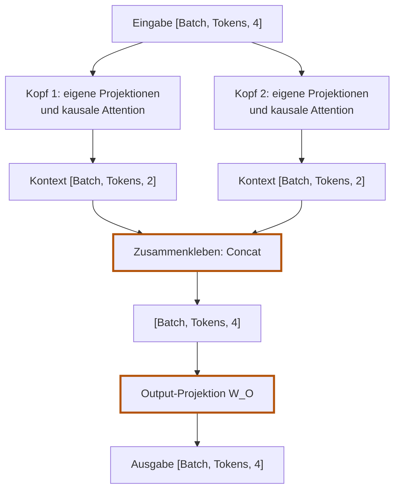

# 5.9 Mehrere Köpfe verbinden

**Lernziel:** Zwei Kontext-Vektoren pro Token zusammenfügen und gemeinsam projizieren.

## Anschluss: Ein Kopf funktioniert bereits

In [5.8](05-08-attention-kopf-in-burn.md) haben wir einen vollständigen
kausalen Attention-Kopf gebaut. Jetzt verwenden wir mehrere davon parallel.
Jeder Kopf rechnet weiterhin projizieren, vergleichen, skalieren, maskieren,
gewichten und mischen.

Für zwei Köpfe der Breite 2 erweitern wir die Eingabebreite jetzt bewusst
von 2 auf 4. Das folgende Zahlenbeispiel beginnt bei den fertigen
Kopf-Ausgaben; es ist keine Fortsetzung der konkreten Zahlen aus 5.8.

## Warum mehrere Mischungen?

Ein Kopf liefert pro Query eine Verteilung über die erlaubten Quellen.
Er kann dabei bereits mehrere Quellen mischen, aber nur mit dieser einen
Verteilung. Mehrere Köpfe berechnen mehrere Verteilungen mit eigenen
Projektionen. So können sie unterschiedliche Informationen hervorheben.

Wir geben nicht vor, dass Kopf 1 Grammatik und Kopf 2 Bedeutung lernen soll.
Solche Spezialisierungen sind möglich, aber weder fest eingebaut noch
garantiert. Neu ist die Möglichkeit, **mehrere Mischungen parallel** zu lernen.

## Das Prinzip: Aufteilen, parallel rechnen, zusammenführen

1. **Breiten festlegen:** Wir verteilen die Ausgabebreite der Projektionen
   auf die Köpfe: hier Breite 4 auf zwei Köpfe mit je Breite 2.
   **Jeder Kopf erhält trotzdem den vollständigen Eingabevektor der Breite 4**,
   nicht nur eine Hälfte davon.
2. **Parallele Attention:** Jeder Kopf rechnet unabhängig seine eigene
   kausale Attention (mit eigenen $W_Q, W_K, W_V$-Matrizen).
3. **Zusammenkleben (Concat):** Die Teilergebnisse beider Köpfe werden
   hintereinandergehängt. Aus zweimal Breite 2 wird wieder die volle Breite 4.
4. **Mischen (Output-Projektion $W_O$):** Eine abschließende lineare Schicht
   vermischt die Erkenntnisse aller Köpfe miteinander.



## Die Handrechnung für 2 Köpfe

Betrachten wir zwei Tokens (Position 0 und 1) mit Einbettungsbreite 4:

### 1. Unabhängige Köpfe rechnen

Jeder Kopf erzeugt für jedes Token einen Kontext-Vektor der Head-Breite 2:

**Kopf 1** liefert:
- Token 0: `[2.0, 0.0]`
- Token 1: `[1.0, 1.5]`

**Kopf 2** liefert:
- Token 0: `[0.0, 1.0]`
- Token 1: `[2.0, 0.5]`

### 2. Zusammenkleben (Concat)

Wir hängen die Vektoren pro Token einfach nebeneinander:

```text
Token 0:
Concat(Kopf 1 [2.0, 0.0], Kopf 2 [0.0, 1.0]) = [2.0, 0.0, 0.0, 1.0]

Token 1:
Concat(Kopf 1 [1.0, 1.5], Kopf 2 [2.0, 0.5]) = [1.0, 1.5, 2.0, 0.5]
```

Form vorher je Kopf: `[1, 2, 2]`.
Form nach Concat: `[1, 2, 4]`. Die Dimension 4 ist wieder hergestellt.

### 3. Warum Concat allein nicht reicht: Die Output-Projektion $W_O$

Nach dem Concat liegen die Zahlen nur nebeneinander im selben Array:
- Platz 1 und 2 gehören stur zu Kopf 1.
- Platz 3 und 4 gehören stur zu Kopf 2.

Concat selbst verrechnet keine Zahlen beider Köpfe miteinander.
Die Output-Projektion übernimmt diesen Schritt; spätere Schichten könnten
ebenfalls Informationen kombinieren. Die lineare Schicht `W_O` ist hier eine
Matrix mit vier Zeilen und vier Spalten. Jede Ausgabekomponente kann Beiträge
aus beiden Köpfen erhalten. Das ist dieselbe Art von Umrechnung wie in 5.4,
diesmal für die zusammengefügten Kontext-Vektoren.

<details>
<summary>Handrechnung: Output-Projektion mit festen Faktoren</summary>

Beispielrechnung für Token 0 mit einer festen $W_O$-Matrix:

```text
Eingabe: [2.0, 0.0, 0.0, 1.0]

         Spalte 1    Spalte 2    Spalte 3    Spalte 4
Kopf 1-A:    1           0           1           0
Kopf 1-B:    0           1           0           1
Kopf 2-A:    1           0          -1           0
Kopf 2-B:    0           1           0          -1
```

Für Ausgabekomponente 1:
```text
  2.0 * 1  (Kopf 1-A)
+ 0.0 * 0  (Kopf 1-B)
+ 0.0 * 1  (Kopf 2-A)
+ 1.0 * 0  (Kopf 2-B)
= 2.0
```

Für Ausgabekomponente 2:
```text
  2.0 * 0 + 0.0 * 1 + 0.0 * 0 + 1.0 * 1 = 1.0
```

Das Ergebnis für Token 0 ist `[2.0, 1.0, 2.0, -1.0]`. Es hat wieder
Länge 4, enthält aber jetzt Informationen aus beiden Köpfen in
gemeinsamer Repräsentation.

</details>

## Den bekannten Kopf im Code mehrfach verwenden

Beim ersten Lesen reicht der didaktische Weg: mehrere vorhandene Köpfe
aufrufen, ihre Ausgaben mit `Tensor::cat` verbinden, Ausgabe projizieren.
Die vollständige Struktur und die optimierte Variante stehen als Vertiefung
darunter. Beide Varianten gehören weiterhin zum Modell-Crate.

```rust,ignore
let head_outputs: Vec<Tensor<3>> = self
    .heads
    .iter()
    .map(|head| head.forward(input.clone()))
    .collect();
let concatenated = Tensor::cat(head_outputs, 2);
self.output_projection.forward(concatenated)
```

Das ist ein Ausschnitt aus `NaiveMultiHeadAttention::forward`, keine
zusätzliche Implementierung. Jeder Kopf verarbeitet dieselbe Eingabe;
Concat verändert nur die Breite, nicht die Zahl oder Reihenfolge der Tokens.

<details>
<summary>Vertiefung: Vollständiger Baustein und optimierte 4D-Variante</summary>

## Multi-Head Attention in Burn: Zwei Wege

Im Code bieten wir beide Varianten an:
1. **`NaiveMultiHeadAttention` (didaktisch):** Eine Liste von `SelfAttention`-Köpfen,
   die nacheinander rechnen, mit `Tensor::cat` verkettet und per $W_O$ gemischt werden.
   Deckungsgleich mit der Handrechnung.
2. **`MultiHeadAttention` (produktiv & optimiert):** Je eine Query-, Key- und
   Value-Projektion für die volle Breite, parallele 4D-Tensoroperationen über alle Köpfe und
   Batch-Dimensionen hinweg. Das ist der Standard für GPU-Training.

Mit entsprechend identischen Parametern berechnen beide dieselbe Funktion
(bis auf Gleitkomma-Rundung). Unabhängig zufällig initialisierte Modelle
liefern nicht automatisch dieselben Zahlen.

### 1. Der didaktische Weg (`NaiveMultiHeadAttention`)

Hier entspricht jede Zeile Code unserer Handrechnung:

```rust,ignore
{{#include ../../../crates/model/src/attention.rs:naive_mha}}
```

Die Schritte in `forward`:
- Jeder Kopf in `self.heads` rechnet unabhängig seine eigene Attention:
  `head.forward(input.clone())`.
- `Tensor::cat(head_outputs, 2)` hängt die Ausgaben entlang der Merkmalsachse
  aneinander (`[1, 2, 2] + [1, 2, 2] -> [1, 2, 4]`).
- `self.output_projection.forward(...)` wendet die $W_O$-Matrix an.

### 2. Der produktive Weg (`MultiHeadAttention` mit 4D-Reshape)

Warum optimieren? Eine Schleife über Köpfe führt viele kleine Kernel-Aufrufe
auf der GPU aus. Viel schneller ist es, **alle Köpfe in einem einzigen großen
Tensor parallel** zu berechnen.

Die Struktur verwendet gemeinsame Projektionen für die volle Breite:

```rust,ignore
{{#include ../../../crates/model/src/attention.rs:mha_config}}
```

Die Vorwärtsrechnung formt die Tensoren geschickt um:

```rust,ignore
{{#include ../../../crates/model/src/attention.rs:mha_forward}}
```

Wie funktioniert der 4D-Trick?

1. **Gemeinsam projizieren:** `query`, `key` und `value` projizieren von
   `[Batch, Tokens, EmbeddingDim]` direkt in `[Batch, Tokens, EmbeddingDim]`.
   Die Kanäle aller Köpfe liegen bereits nebeneinander.
2. **Form aufteilen (`project_and_split`):**
   - `.reshape([Batch, Tokens, Heads, HeadDim])`: Trennt die flache
     Merkmalsachse in Köpfe und Kopf-Breite auf.
   - `.swap_dims(1, 2)`: Tauscht Achse 1 und 2 $\to$
     `[Batch, Heads, Tokens, HeadDim]`.
   - Jetzt verhält sich jede Kopf-Ebene wie ein eigener Batch!
3. **Paralleles Matmul:**
   - `q.matmul(k.swap_dims(2, 3))` berechnet alle Scores für alle Köpfe
     und alle Batches in einer einzigen GPU-Operation.
   - Form: `[Batch, Heads, Tokens, Tokens]`.
4. **Kausale Maske:** Die 2D-Maske `[Tokens, Tokens]` wird per `.unsqueeze()`
   auf `[1, 1, Tokens, Tokens]` erweitert. Burn broadcastet sie automatisch
   über alle Batches und Köpfe.
5. **Zurückformen:**
   - Nach `weights.matmul(v)` haben wir `[Batch, Heads, Tokens, HeadDim]`.
   - `.swap_dims(1, 2)` $\to$ `[Batch, Tokens, Heads, HeadDim]`.
   - `.reshape([Batch, Tokens, EmbeddingDim])` klebt die Köpfe wieder zusammen.
6. **Output-Projektion:** `self.output_projection.forward(merged)`.

## Der Beweis: Beide Wege sind numerisch identisch

In `crates/model/tests/attention.rs` verifizieren wir, dass die optimierte
4D-Variante und die didaktische Einzelschritt-Variante auf dieselben Zahlen
führen:

```rust,ignore
{{#include ../../../crates/model/tests/attention.rs:test_mha_equivalence}}
```

```bash
cargo test -p model --test attention naive_and_batched_multi_head_attention_are_numerically_equivalent
```

</details>

## Die Ausgabe der Demo

Das Beispiel `crates/model/examples/ch05_multi_head.rs` führt beide
Varianten aus. Es verwendet zufällig initialisierte Parameter und andere
Eingabezahlen als die Handrechnung oben. Die beiden Modelle werden unabhängig
initialisiert und liefern deshalb unterschiedliche Werte. Der Gleichheitstest
in der Vertiefung verwendet dagegen gezielt übereinstimmende Parameter.

```bash
cargo run -p model --example ch05_multi_head
```

```text
{{#include ../ausgaben/ch05_multi_head.txt}}
```

Beide liefern Tensoren der Form `[1, 2, 4]`. Für das weitere Training und
die Transformer-Blöcke in Kapitel 6 nutzen wir die produktive `MultiHeadAttention`.

## Selbst versuchen

Zwei Köpfe liefern für ein Token `[1, 2]` und `[3, 4]`.
Was liefert Concat? Ist das dasselbe wie komponentenweise Addition?
Muss danach eine weitere Token-Position entstehen?

<details>
<summary>Lösung anzeigen</summary>

Concat liefert `[1, 2, 3, 4]`. Komponentenweise Addition wäre `[4, 6]`
und ist eine andere Operation. Es bleibt dieselbe Token-Position.
Die Output-Projektion kann danach alle vier Komponenten miteinander
verrechnen und liefert in unserem Baustein wieder Breite 4.

</details>

## Was bleibt?

**Mehrere Köpfe bilden mehrere Mischungen. Concat hängt sie aneinander;
die Output-Projektion verrechnet sie.** Kein neuer Vergleichsmechanismus:
Jeder Kopf verwendet die Rechnung aus den vorherigen Seiten.

## Rückblick ohne Nachschlagen

Erkläre den Weg vom Token-Vektor zur Ausgabe anhand dieser Fragen.
Wenn eine Antwort fehlt, springe gezielt zur passenden Seite:

- Woher kommen die Inhalte und wie mischen wir sie? [5.1](05-01-informationen-mischen.md)
- Wie bestimmen Query und Keys die Anteile? [5.2](05-02-anteile-berechnen.md)
- Wie entstehen Query, Key und Value? [5.4](05-04-projektionen.md)
- Welche Zahlen sind Parameter? [5.5](05-05-lernbare-parameter.md)
- Wo gehören Skalierung und Maske hin? [5.6](05-06-scores-skalieren.md), [5.7](05-07-zukunft-ausblenden.md)
- Wie bleibt die Rechnung für mehrere Fenster getrennt? [5.8](05-08-attention-kopf-in-burn.md)

Damit ist unser Attention-Baustein vollständig. Kapitel 6 ergänzt
Residualverbindungen, LayerNorm und ein Feedforward-Netz zum Transformer-Block.

Zurück: [5.8 Einen Attention-Kopf in Burn bauen](05-08-attention-kopf-in-burn.md).
Weiter: [6. Der Transformer-Block](06-transformer-block.md).
