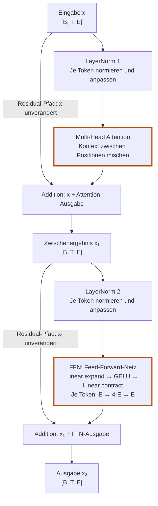

# 6.4 Den Transformer-Block zusammensetzen

**Lernziel:** Du verstehst, wie LayerNorm, Attention, Feed-Forward-Netz
und Residual-Verbindungen gemeinsam einen Transformer-Block bilden.
Du kannst im Diagramm verfolgen, welche Vektoren verarbeitet und welche
unverändert zur jeweiligen Addition weitergegeben werden. Dabei erkennst
du, warum das FFN erst nach dem Attention-Teilschritt arbeitet und weshalb
die Ausgabe trotzdem dieselbe Form wie die Eingabe hat.

## Anschluss: Die bekannten Teile verbinden

Wir kennen LayerNorm aus [6.1](06-01-layernorm.md), das FFN aus
[6.2](06-02-feed-forward.md) und Residual-Verbindungen aus
[6.3](06-03-residual-verbindungen.md). Zusammen mit Multi-Head Attention
aus Kapitel 5 ergeben sie den Transformer-Block.

Das folgende Diagramm zeigt ihren Platz im Block. `x` bezeichnet die
Eingabe, `x₁` das Ergebnis nach dem Attention-Teilschritt und `x₂` die
Ausgabe des gesamten Blocks. Jeder dieser Tensoren enthält einen Vektor
pro Token-Position, nicht nur einen einzelnen Token-Vektor.



In der **ersten Hälfte** erhält Attention die durch LayerNorm 1
aufbereitete Eingabe. Ihre Ausgabe wird zum ursprünglichen `x` addiert.
In der **zweiten Hälfte** verarbeitet das FFN das durch LayerNorm 2
aufbereitete Zwischenergebnis `x₁`; seine Ausgabe wird zu `x₁` addiert.
Das FFN ist also ein eigener Baustein nach Attention, kein Teil davon.

Die seitlichen Residual-Pfade umgehen jeweils sowohl LayerNorm als auch
den verarbeitenden Baustein. „Unverändert“ gilt dabei nur für den direkten
Weg bis zur Addition: Nach der Addition entsteht ein neuer Vektor.
Die Anordnung heisst **Pre-LayerNorm**, weil die Normierung jeweils
vor Attention beziehungsweise FFN steht.

## Die Eingabe `x`: Rückblick auf das Embedding

Der **erste Block** bekommt als Eingabe `x` die Ausgabe von `GptEmbedding`
(Kapitel 3). Spätere Blöcke bekommen die Ausgabe ihres Vorgängerblocks:
bereits verarbeitete Token-Vektoren mit Kontext. Die Form `[B, T, E]`
bleibt an diesen Übergängen gleich.

Für den ersten Block besteht das Embedding aus zwei Nachschlagetabellen
und einer Addition:

```text
token:     Tabelle [vocab_size, E]          eine Zeile pro Token-ID
position:  Tabelle [max_context_length, E]  eine Zeile pro Position
x = token[id] + position[pos]
```

Beispiel mit `E = 2`, Token-ID 5 an Position 1 (die Zahlen sind erfunden):

```text
token[5]    = [0.3, -0.1]
position[1] = [0.0,  0.2]
x           = [0.3,  0.1]
```

Dasselbe Token an Position 3 ergibt einen anderen Vektor, weil `position[3]`
anders ist. So kennt das Modell die Reihenfolge, die Attention allein nicht
sieht.

## Der Aufbau des Blocks

Jetzt haben wir alle Teile: LayerNorm, Attention, Feed-Forward und die
Residual-Idee. Der Block setzt sie in zwei Teilschritten zusammen. Jeder
Teilschritt hat dasselbe Muster:

```text
neues x = altes x + Schicht( LayerNorm( altes x ) )
```

Konkret:

```text
x₁ = x  + Attention  ( LayerNorm₁(x)  )     Teilschritt A
x₂ = x₁ + FeedForward( LayerNorm₂(x₁) )     Teilschritt B
```

- **A:** Die Positionen tauschen Informationen aus (Attention).
- **B:** Jede Position verarbeitet ihren Vektor weiter (FFN). Der Vektor `x₁`
  enthält schon den Kontext aus A.
- In beiden Teilschritten wird `x` **nicht ersetzt**, sondern ergänzt. Das ist
  die Residual-Verbindung aus [6.3](06-03-residual-verbindungen.md).
- Die LayerNorm steht jeweils *vor* der Schicht (Pre-LayerNorm). Sie normiert
  nur das, was in die Schicht hineingeht. Der Pfad `x` → `+` bleibt
  unnormiert.

Die Formeln beschreiben die beiden Additionen im Diagramm am Seitenanfang.
Die Ein- und Ausgaben der gezeigten Bausteine haben die Form `[B, T, E]`.
Intern dürfen Formen wechseln: Das FFN erweitert auf `[B, T, 4·E]`,
und Attention verwendet unter anderem die 4D-Tensoren aus Kapitel 5.9.

## Wer macht was im Block?

Der Block gewichtet nicht einfach Embeddings. Er rechnet sie Schicht um Schicht
in neue Vektoren um. Nur eine Stelle mischt zwischen Tokens:

| Teil | Tauscht Information zwischen Tokens? | Was passiert |
| ---- | ------------------------------------ | ------------ |
| Attention | **ja** | Softmax-Anteile bestimmen, wie stark vorherige Tokens eingemischt werden |
| LayerNorm | nein | normiert je Token und passt Komponenten mit `γ` und `β` an |
| Feed-Forward | nein | rechnet jeden Vektor für sich um (Matrix, GELU, Matrix) |
| Residual | nein | addiert den alten Vektor über einen direkten Informations- und Gradientenpfad |

Als Faustregel: Attention fragt "Was im Kontext ist für mich relevant?", das
Feed-Forward-Netz fragt "Was mache ich daraus?".

**Achtung, zwei Bedeutungen von "Gewichte":**

- **Attention-Gewichte:** Anteile pro Token-Paar. Sie werden bei jeder Eingabe
  neu berechnet und sind keine Parameter.
- **Modellgewichte (Parameter):** die Zahlen in `Linear`, `γ`, `β` und den
  Embedding-Tabellen. Sie ändern sich nur im Training.

## Selbst versuchen

Welche Version von `x` wird bei der ersten Residual-Addition verwendet:
die ursprüngliche oder die normierte? Welchen Vektor normiert
die zweite LayerNorm?

<details>
<summary>Lösung anzeigen</summary>

Die erste Addition verwendet das ursprüngliche `x`. Nur der Attention-Zweig
erhält `LayerNorm₁(x)`. Die zweite LayerNorm verarbeitet `x₁`, also
das Ergebnis der ersten Residual-Addition. Auch dort bleibt der direkte
Pfad zur Addition unnormiert.

</details>

## Was bleibt?

**Zweimal dasselbe Muster: normieren, verarbeiten, Eingabe dazuaddieren.**
Attention tauscht Kontext zwischen Positionen aus, das FFN verarbeitet
ihn je Token weiter. Die Residual-Pfade umgehen jeweils die LayerNorm.

Zurück: [6.3 Residual-Verbindungen](06-03-residual-verbindungen.md).
Weiter: [6.5 Den Block in Rust bauen](06-05-block-in-rust.md).
