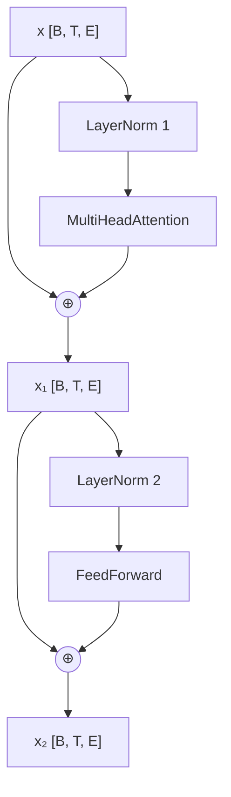
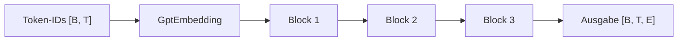

# 6. Der Transformer-Block

## Lernziel und Lernpfad

Kapitel 5 hat Attention fertiggestellt: `MultiHeadAttention` mischt Informationen
aus vorherigen Positionen in jeden Token-Vektor. Die Form bleibt dabei gleich:
`[Fenster, Position, Embedding]` rein, `[Fenster, Position, Embedding]` raus.

Genau das erlaubt es, mehrere solche Bausteine **hintereinander** zu schalten.
Ein GPT-Modell besteht aus vielen gleich gebauten Blöcken. Ein einzelner Block
braucht neben Attention drei weitere Teile:

1. **Feed-Forward-Netz:** verarbeitet jeden Token-Vektor einzeln weiter.
   Attention mischt zwischen Positionen, das Feed-Forward-Netz rechnet
   innerhalb einer Position.
2. **Residual-Verbindung:** addiert die Eingabe zur Ausgabe einer Schicht.
3. **LayerNorm:** hält die Zahlen eines Token-Vektors in einem handlichen
   Bereich.

Wir erarbeiten den Block in diesen Schritten:

1. LayerNorm von Hand rechnen und selbst bauen.
2. Feed-Forward-Netz.
3. Residual-Verbindungen.
4. Den Aufbau des Blocks verstehen.
5. Den `TransformerBlock` in Rust umsetzen.
6. Mehrere Blöcke hinter das Embedding schalten und Eigenschaften testen.

Die Modellberechnung steht im Crate `model`. Training, Verlustfunktion und
Optimizer folgen später im Crate `training`. Dieses Kapitel berechnet nur
Vorwärtsdurchläufe und prüft, dass Gradienten fliessen.

**Entscheidung:** Wir verwenden die **Pre-LayerNorm**-Anordnung wie GPT-2:
LayerNorm steht *vor* Attention und Feed-Forward, nicht dahinter. Das
Originalpaper "Attention Is All You Need" setzt LayerNorm dagegen hinter die
Residual-Addition (Post-LayerNorm).

## Schritt 1: LayerNorm

### Kurz erklärt: Achsen

Eine **Achse** ist eine Richtung im Tensor. Jede Zahl in der Form steht für
eine Achse. Gezählt wird ab 0. Das entspricht der Verschachtelungstiefe, etwa
in Kotlin:

```text
Vektor  [4]       1 Achse    List<Float>
Matrix  [3, 4]    2 Achsen   List<List<Float>>
Tensor  [2, 3, 4] 3 Achsen   List<List<List<Float>>>
```

Unser Tensor `[B, T, E]` hat drei Achsen:

| Achse | Name | Bedeutung                       |
| ----- | ---- | ------------------------------- |
| 0     | B    | welches Fenster                 |
| 1     | T    | welches Token im Fenster        |
| 2     | E    | welche Komponente des Vektors   |

Bei `[2, 4, 8]` gibt es 2 Fenster mit je 4 Tokens und je 8 Zahlen.

**Über eine Achse rechnen** heisst: Diese Achse wird zusammengefasst, alle
anderen bleiben getrennt. `mean_dim(2)` mittelt für jedes (Fenster, Token)
die 8 Zahlen und liefert die Form `[2, 4, 1]`. Merkhilfe: Achse 2 ist die
innerste Liste.

### Das Problem

Nach mehreren Schichten können die Zahlen eines Vektors sehr gross oder sehr
klein werden. Das macht das Training instabil. LayerNorm bringt jeden
Token-Vektor auf **Mittelwert 0** und **Varianz 1**, jeden Vektor einzeln.

- **Mittelwert 0** heisst: Die Zahlen eines Vektors liegen im Schnitt um null.
  Positive und negative Werte heben sich auf.
- **Varianz 1** heisst: Die Zahlen streuen "normal breit". Die Varianz ist der
  Mittelwert der quadrierten Abweichungen vom Mittelwert. `[10, 10, 30, 30]`
  streut weit (Varianz 100), `[0.1, 0.1, 0.3, 0.3]` eng (Varianz 0.01).

Nach LayerNorm liegen so alle Vektoren auf derselben Skala, egal wie gross die
Zahlen vorher waren.

### Handrechnung

Der Token-Vektor `x = [1, 2, 3, 4]`:

```text
Mittelwert  μ  = (1 + 2 + 3 + 4) / 4              = 2.5
Abweichungen   = [-1.5, -0.5, 0.5, 1.5]
Varianz     σ² = (2.25 + 0.25 + 0.25 + 2.25) / 4  = 1.25
Wurzel      σ  = √1.25                            ≈ 1.118
Normiert    x̂  = Abweichungen / σ                 ≈ [-1.342, -0.447, 0.447, 1.342]
```

Die Varianz ist der Mittelwert der quadrierten Abweichungen. Sie ist ein Mass
dafür, wie weit die Zahlen streuen.

Danach folgt ein lernbarer Schritt:

```text
Ausgabe = γ · x̂ + β
```

`γ` (scale) und `β` (shift) sind zwei Vektoren der Länge `E`. Sie starten mit
`γ = 1` und `β = 0`. Das Training darf sie ändern, falls das Modell andere
Bereiche braucht. Zu Beginn ändern sie nichts.

Eine winzige Konstante `ε` (epsilon, hier `1e-5`) wird zur Varianz addiert.
Hätte ein Vektor lauter gleiche Zahlen, wäre die Varianz 0 und die Division
`0 / 0` ergäbe `NaN`. Mit `ε` bleibt das Ergebnis 0. `ε` ist fest und wird
nicht gelernt, deshalb ist es ein normales Feld und kein `Param`.

### Welche Achse?

Wir normieren über **Achse 2**, die Embedding-Achse. Für jedes Token werden
also dessen `E` Zahlen zusammen betrachtet: ein Mittelwert und eine Varianz pro
Token. Andere Tokens und andere Fenster fliessen nicht ein.

```text
Eingabe [2, 4, 8]  →  2 · 4 = 8 Token-Vektoren mit je 8 Zahlen
                      →  8 Mittelwerte und 8 Varianzen, Form [2, 4, 1]
```

Auch Softmax in Attention rechnete über Achse 2, nur hatte sie dort eine andere
Bedeutung: In den Scores `[B, T, T]` läuft Achse 2 über die Keys. Dieselbe
Achsennummer kann also je nach Tensor etwas anderes bedeuten.

### Der Code

```rust,ignore
{{#include ../../../crates/model/src/layer_norm.rs:config}}
```

`Param` markiert Tensoren, die Burn als lernbar behandelt. `scale` und `shift`
sind Vektoren (`Tensor<1>`).

```rust,ignore
{{#include ../../../crates/model/src/layer_norm.rs:forward}}
```

Zeile für Zeile:

- `mean_dim(2)` bildet den Mittelwert über die Embedding-Achse. Die Form wird
  `[B, T, 1]`: Die Achse bleibt mit Länge 1 erhalten.
- `input - mean` zieht von jedem Wert den Mittelwert seines Tokens ab.
  Burn streckt die Achse der Länge 1 automatisch (Broadcasting).
- `centered.clone()`: `centered` wird zweimal gebraucht, für die Varianz und
  für die Division. Tensor-Operationen verbrauchen ihre Eingabe (Move), also
  brauchen wir einen Clone. Er kopiert die Daten nicht.
- `scale` hat Form `[E]`, `normalized` hat `[B, T, E]`. Burn rechnet nur mit
  gleichem Rang. `reshape([1, 1, E])` macht aus `[E]` die Form `[1, 1, E]`,
  und Broadcasting verteilt sie auf alle Fenster und Positionen.

### Ausführen

```rust,ignore
{{#include ../../../crates/model/examples/ch06_layer_norm.rs}}
```

```bash
cargo run -p model --example ch06_layer_norm
```

```text
{{#include ../ausgaben/ch06_layer_norm.txt}}
```

Token 0 entspricht der Handrechnung. Token 1 hat die Streuung 100 und landet
trotzdem bei Varianz 1: Die Grösse der Zahlen spielt nach LayerNorm keine
Rolle mehr.

### Gegenprobe mit Burn

Wir haben LayerNorm selbst gebaut. Stimmt die Rechnung? Burn bringt
`burn::nn::LayerNorm` mit. Wenn beide bei gleicher Eingabe und gleichen
Parametern dasselbe liefern, ist unsere Version korrekt. Das ist ein
stärkerer Beleg als die Handrechnung eines einzelnen Tokens.

```rust,ignore
{{#include ../../../crates/model/tests/layer_norm.rs:compare}}
```

Was die Tests tun:

- **Erster Test:** Beide Module starten mit `γ = 1` und `β = 0`. Die Eingabe hat
  zwei Tokens. Die Ausgaben werden Zahl für Zahl verglichen (`zip` paart je
  eine Zahl von uns mit der von Burn).
- **Zweiter Test:** Wir setzen in beiden Modulen dieselben Werte für `γ` und
  `β`. So prüfen wir auch den lernbaren Teil `γ · x̂ + β`, der mit den
  Startwerten nichts verändert.
- **Toleranz statt Gleichheit:** Wir vergleichen mit `< 1e-4` statt mit `==`.
  Gleitkommazahlen runden. Burn rechnet intern in anderer Reihenfolge
  (eine fertig zusammengefasste Operation des Backends), daher können die
  letzten Nachkommastellen abweichen, ohne dass die Rechnung anders wäre.

Zwei Unterschiede im Aufbau fallen auf:

| Unser Modul | Burns Modul          |
| ----------- | -------------------- |
| `scale`     | `gamma`              |
| `shift`     | `beta` (optional)    |
| nur `[B, T, E]` (`Tensor<3>`) | beliebiger Rang |

Wir haben bewusst nur den Fall gebaut, den der Transformer-Block braucht.
Im Rest des Kapitels bleibt unser eigenes `LayerNorm` im Block. Du kannst es
später durch `burn::nn::LayerNorm` ersetzen, ohne das Verhalten zu ändern.

```bash
cargo test -p model --test layer_norm
```

Weitere Tests prüfen Mittelwert und Varianz je Token, Gradienten für `scale`
und `shift` und die Fehlermeldung bei falscher Embedding-Breite.

## Schritt 2: Feed-Forward-Netz

### Warum noch eine Schicht?

Attention hat Informationen **zwischen** Positionen gemischt. Danach soll jeder
Token-Vektor für sich weiterverarbeitet werden: Was hat das Token aus seinem
Kontext gelernt, und was folgt daraus? Das übernimmt ein kleines Netz, das auf
jeden Token-Vektor **einzeln** angewendet wird, also ohne Blick auf andere
Positionen. Der Vektor enthält durch Attention aber bereits Kontext (der
ganze Datenweg steht in Schritt 4). Man nennt es Feed-Forward-Netz
(FFN), weil Daten nur vorwärts durch zwei Schichten laufen.

### Aufbau

```text
E  →  Linear (expand)  →  4·E  →  GELU  →  Linear (contract)  →  E
```

- **expand** weitet den Vektor von `E` auf `4·E` Zahlen. Der Faktor 4 ist der
  GPT-2-Standard. Im weiten Raum hat das Netz mehr Platz, Merkmale zu trennen.
- **GELU** bringt die Nichtlinearität. Ohne sie wären zwei Linear-Schichten
  nur eine einzige Matrix (siehe
  [Exkurs: Aktivierungsfunktionen und GELU](../exkurse/aktivierung-gelu.md)).
- **contract** verengt wieder auf `E`. Nur so passt die Form zur
  Residual-Addition in Schritt 3.

### Der Code

```rust,ignore
{{#include ../../../crates/model/src/feed_forward.rs:config}}
```

`expand` und `contract` sind zwei `Linear`-Schichten. Anders als bei den
Attention-Projektionen haben sie einen Bias (Standard von `LinearConfig`).

```rust,ignore
{{#include ../../../crates/model/src/feed_forward.rs:forward}}
```

Die Methode hat nur zwei Zeilen: erst `expand` und `gelu`, dann `contract`.
Der Eingang ist `Tensor<3>` mit Form `[B, T, E]`. `Linear` wirkt auf die
letzte Achse, Achse 2. Alle Fenster und Positionen werden so mit denselben
Gewichten behandelt, jede für sich.

### Ausführen

```rust,ignore
{{#include ../../../crates/model/examples/ch06_feed_forward.rs}}
```

```bash
cargo run -p model --example ch06_feed_forward
```

```text
{{#include ../ausgaben/ch06_feed_forward.txt}}
```

Zum Lesen:

- Die Form wird in der Mitte breiter (`8 = 4 · 2`) und am Ende wieder `[1, 3, 2]`.
- Token 0 und Token 2 haben denselben Eingabevektor und bekommen dieselbe
  Ausgabe. Das FFN weiss nichts von Positionen und Nachbarn. Sie kommen allein
  aus Attention und Positions-Embedding.
- Parameter bei `E = 2`: `(2·8 + 8) + (8·2 + 2) = 24 + 18 = 42`.

Bei `E = 8` liegen im FFN mehr Parameter als in der Attention (552 gegen 256,
siehe Schritt 6). Ein grosser Teil des Wissens eines GPT steckt in diesen
Schichten.

```bash
cargo test -p model --test transformer_block feed_forward
```

## Schritt 3: Residual-Verbindungen

### Das Problem: Gradienten verschwinden

Kapitel 4 hat gezeigt: Beim Rückwärtsrechnen multipliziert Autograd die
Ableitungen aller Schichten. Wirkt jede Schicht nur schwach (Faktor `0.1`),
schrumpft der Gradient mit jeder Schicht um den Faktor 10. Nach zehn Schichten
kommt am Anfang fast nichts mehr an. Die ersten Schichten können dann nicht
mehr lernen.

### Die Lösung: Eingabe dazuaddieren

```text
ohne Residual:  y = Schicht(x)
mit  Residual:  y = x + Schicht(x)
```

Die Schicht muss den Vektor nicht komplett neu erzeugen. Sie liefert nur eine
**Änderung**, die auf `x` aufgerechnet wird. Beim Ableiten wird aus
`y = x + f(x)` der Gradient `1 + f'(x)`. Die `1` stammt aus der direkten
Verbindung und bleibt auch erhalten, wenn `f'(x)` winzig ist.

### Wann kommt die Addition zum Zug?

Residual ist keine eigene Schicht, sondern eine Addition. Sie steht **direkt
nach** einer Schicht, im Block also zweimal:

```text
x
├─→ LayerNorm → Attention ─┐
└──────────────────────────┴→ ⊕  = x₁     Residual 1
```

Zahlenbeispiel mit `E = 2` (die Zahlen sind erfunden):

```text
x                    = [1.0,  2.0]
Attention-Ausgabe    = [0.1, -0.2]
x₁ = x + Ausgabe     = [1.1,  1.8]
```

Die Schicht hat `x` nur leicht verändert, nicht ersetzt. Liefert sie
`[0, 0]`, bleibt `x₁ = x`: Der Block kann eine Schicht also "ausschalten", ohne
Information zu verlieren. Der zweite Teilschritt im Block (Feed-Forward) folgt
demselben Muster.

### Ausprobieren

Die Demo schaltet bis zu zehn Schichten hintereinander. Jede Schicht multipliziert
mit `0.1` (eine bewusst schwache Schicht). Wir fragen nach dem Gradienten am
Eingang:

```rust,ignore
{{#include ../../../crates/model/examples/ch06_residual.rs:stack}}
```

- `require_grad()` markiert `x`, damit Burn dessen Gradienten merkt.
- `hidden + update` ist die Residual-Addition, `update` allein ist die Variante
  ohne.
- `backward()` rechnet rückwärts, `x.grad(&grads)` liest den Gradienten für `x`.

```bash
cargo run -p model --example ch06_residual
```

```text
{{#include ../ausgaben/ch06_residual.txt}}
```

Ohne Residual wird der Gradient mit jeder Schicht zehnmal kleiner
(`1e-10` nach zehn Schichten). Mit Residual bleibt er bei etwa 1, er wächst
sogar leicht: `1.1^10 ≈ 2.594`. Die Demo ist künstlich einfach, zeigt aber den
Mechanismus, der auch in einem echten Modell wirkt.

### Formen müssen passen

Eine Addition `a + b` geht nur, wenn beide Tensoren dieselbe Form haben. Bei
`y = x + Schicht(x)` heisst das: Die Schicht muss wieder `[B, T, E]`
zurückgeben, wenn `x` die Form `[B, T, E]` hat.

`MultiHeadAttention` und `FeedForward` tun genau das. Hätte das FFN nach
`expand` aufgehört und `4·E` Zahlen geliefert, ginge die Addition nicht auf.
Deshalb gibt es `contract`.

## Schritt 4: Der Block

### Die Eingabe `x`: Rückblick auf das Embedding

Der Block bekommt als Eingabe `x` die Ausgabe von `GptEmbedding`
(Kapitel 3). Das Embedding besteht aus zwei Nachschlagetabellen und einer
Addition:

```text
token:     Tabelle [vocab_size, E]          eine Zeile pro Token-ID
position:  Tabelle [max_context_length, E]  eine Zeile pro Position
x = token[id] + position[pos]
```

Beispiel mit `E = 2`, Token-ID 5 an Position 1 (die Zahlen sind erfunden):

```text
token[5]    = [0.3, -0.1]
position[1] = [0.0,  0.2]
x           = [0.3,  0.1]
```

Dasselbe Token an Position 3 ergibt einen anderen Vektor, weil `position[3]`
anders ist. So kennt das Modell die Reihenfolge, die Attention allein nicht
sieht.

### Der Aufbau des Blocks

Jetzt haben wir alle Teile: LayerNorm, Attention, Feed-Forward und die
Residual-Idee. Der Block setzt sie in zwei Teilschritten zusammen. Jeder
Teilschritt hat dasselbe Muster:

```text
neues x = altes x + Schicht( LayerNorm( altes x ) )
```

Konkret:

```text
x₁ = x  + Attention  ( LayerNorm₁(x)  )     Teilschritt A
x₂ = x₁ + FeedForward( LayerNorm₂(x₁) )     Teilschritt B
```

- **A:** Die Positionen tauschen Informationen aus (Attention).
- **B:** Jede Position verarbeitet ihren Vektor weiter (FFN). Der Vektor `x₁`
  enthält schon den Kontext aus A.
- In beiden Teilschritten wird `x` **nicht ersetzt**, sondern ergänzt. Das ist
  die Residual-Verbindung aus Schritt 3.
- Die LayerNorm steht jeweils *vor* der Schicht (Pre-LayerNorm). Sie normiert
  nur das, was in die Schicht hineingeht. Der Pfad `x` → `+` bleibt
  unnormiert.

Als Diagramm (nur der Block; `x` kommt von aussen):



Lies den Pfeil von `x` zu `⊕` als Abkürzung: Er umgeht LayerNorm und
Attention und kommt unverändert an der Addition an. Das Gleiche gilt für `x₁`.
Die Form ist an jeder Stelle `[B, T, E]`.

### Wer macht was im Block?

Der Block gewichtet nicht einfach Embeddings. Er rechnet sie Schicht um Schicht
in neue Vektoren um. Nur eine Stelle mischt zwischen Tokens:

| Teil | Tauscht Information zwischen Tokens? | Was passiert |
| ---- | ------------------------------------ | ------------ |
| Attention | **ja** | Softmax-Anteile bestimmen, wie stark vorherige Tokens eingemischt werden |
| LayerNorm | nein | bringt jeden Vektor auf Mittelwert 0 und Varianz 1 |
| Feed-Forward | nein | rechnet jeden Vektor für sich um (Matrix, GELU, Matrix) |
| Residual | nein | addiert den alten Vektor dazu, damit nichts verloren geht |

Als Faustregel: Attention fragt "Was im Kontext ist für mich relevant?", das
Feed-Forward-Netz fragt "Was mache ich daraus?".

**Achtung, zwei Bedeutungen von "Gewichte":**

- **Attention-Gewichte:** Anteile pro Token-Paar. Sie werden bei jeder Eingabe
  neu berechnet und sind keine Parameter.
- **Modellgewichte (Parameter):** die Zahlen in `Linear`, `γ`, `β` und den
  Embedding-Tabellen. Sie ändern sich nur im Training.

## Schritt 5: Der Block in Rust

Jetzt setzen wir das Diagramm aus Schritt 4 in Code um. Der Block fasst die
Bausteine aus den Schritten 1 bis 3 und die `MultiHeadAttention` aus
Kapitel 5 zusammen.

### Der Code

```rust,ignore
{{#include ../../../crates/model/src/transformer_block.rs:config}}
```

Der Block hat vier Felder: zwei LayerNorms, die Attention und das FFN. Es gibt
zwei LayerNorms, weil jede ihre eigenen `γ` und `β` lernt. Burns
`#[derive(Module)]` sammelt die Parameter aller Felder automatisch ein.

```rust,ignore
{{#include ../../../crates/model/src/transformer_block.rs:forward}}
```

Die vier Zeilen entsprechen den Formeln:

| Zeile im Code | Formel |
| ------------- | ------ |
| `normed = attention_norm.forward(input.clone())` | `LayerNorm₁(x)` |
| `after_attention = input + attention.forward(normed)` | `x₁ = x + Attention(…)` |
| `normed = feed_forward_norm.forward(after_attention.clone())` | `LayerNorm₂(x₁)` |
| `after_attention + feed_forward.forward(normed)` | `x₂ = x₁ + FeedForward(…)` |

Zwei Rust-Punkte:

- **`clone()`:** `input` wird zweimal gebraucht, in der LayerNorm und in der
  Addition. Tensor-Operationen verbrauchen ihre Eingabe, also geben wir der
  LayerNorm einen Clone. Dasselbe gilt für `after_attention`. Der Clone kopiert
  keine Daten.
- **Shadowing:** `let normed` steht zweimal. Die zweite Zeile legt eine neue
  Variable gleichen Namens an und verdeckt die erste. Die erste wurde schon an
  die Attention übergeben und wird nicht mehr gebraucht.

Die kausale Maske steckt in `MultiHeadAttention`. Der Block erbt sie, ohne
selbst etwas zu tun.

## Schritt 6: Mehrere Blöcke hinter dem Embedding

Bisher haben wir einen Block betrachtet. Ein GPT stapelt viele davon
(GPT-2 small: 12). Das geht, weil jeder Block `[B, T, E]` annimmt und
`[B, T, E]` zurückgibt: Die Ausgabe des einen ist die Eingabe des nächsten.



Jeder Block hat **eigene** Parameter. Block 2 ist also nicht Block 1 ein
zweites Mal, sondern eine neue Instanz mit eigenen Gewichten.

### Blöcke hintereinander

```rust,ignore
{{#include ../../../crates/model/examples/ch06.rs:stack}}
```

`fold` reicht einen Wert durch eine Kette von Schritten. Start ist die
Embedding-Ausgabe. Jeder Block bekommt das bisherige `hidden` und liefert das
nächste. Das entspricht in Kotlin `blocks.fold(start) { hidden, block -> block(hidden) }`.

### Ausführen

```bash
cargo run -p model --example ch06
```

```text
{{#include ../ausgaben/ch06.txt}}
```

Die Ausgabe hat drei Teile:

1. **Vektoren pro Stufe.** Wir zeigen die ersten vier Zahlen von Token 0 nach
   dem Embedding und nach jedem Block. Die Werte ändern sich in jedem Block, die
   Form bleibt `[1, 4, 8]`. Der Block formt den Vektor also um, ohne ihn zu
   ersetzen (Residual).
2. **Parameter.** Drei Blöcke mit `E = 8` haben `3 · 840 = 2520` Parameter.
   Die Rechnung für einen Block steht unten.
3. **Kausalität.** Wir ändern das *letzte* Token (4 → 9). Die Ausgaben von
   Token 0 bis 2 bleiben exakt gleich, nur Token 3 ändert sich. Token blicken
   nur nach hinten, deshalb kann eine spätere Änderung frühere Positionen nicht
   beeinflussen. Das ist die kausale Maske aus Kapitel 5, die jetzt durch drei
   Blöcke hindurch hält.

Die konkreten Zahlen hängen von der zufälligen Startinitialisierung ab. Bei
einem erneuten Lauf sehen sie anders aus. Die Formen, die Parameterzahl und das
Ergebnis der Kausalitätsprüfung bleiben gleich.

Die Parameterzahl eines Blocks lässt sich nachrechnen (`E = 8`):

```text
Attention:     4 Matrizen à 8·8                 = 256
LayerNorm:     2 × (γ: 8 + β: 8)                =  32
Feed-Forward:  (8·32 + 32) + (32·8 + 8)         = 552
Summe                                           = 840
```

### Tests

```bash
cargo test -p model --test transformer_block
```

Die Tests prüfen:

- Die Form bleibt erhalten, auch hinter `GptEmbedding`.
- **Kausalität:** Ändert sich Token 1, bleibt die Ausgabe für Token 0
  unverändert.
- Gradienten kommen bei Attention, Feed-Forward und beiden LayerNorms an.
- Die Parameterzahl entspricht der Rechnung oben.

## Die Zusammenhänge wiederfinden

- **Formen:** Alle Teile geben `[B, T, E]` zurück. Nur deshalb sind
  Residual-Addition und das Hintereinanderschalten möglich.
- **Achsen:** Softmax normiert über Keys, LayerNorm über Embedding-Komponenten,
  das Feed-Forward-Netz rechnet je Position.
- **Rust:** `clone()` erhält einen Tensor für die zweite Verwendung. Es kopiert
  die Daten nicht.
- **Pre-LayerNorm:** Der Residual-Pfad bleibt ohne LayerNorm. Nur der Weg durch
  die Schicht wird normiert.

## Zusammenfassung

Ein Transformer-Block verbindet Multi-Head-Attention und Feed-Forward-Netz.
Beide sind mit LayerNorm davor und einer Residual-Verbindung darum versehen.
Die Form bleibt gleich, daher lassen sich Blöcke stapeln.

## Was als Nächstes kommt

Das Modell besteht noch aus Einzelteilen. Das nächste Kapitel stapelt mehrere
Blöcke hinter dem Embedding und ergänzt eine Ausgabeschicht, die für jede
Position Werte für alle Tokens des Vokabulars liefert.
