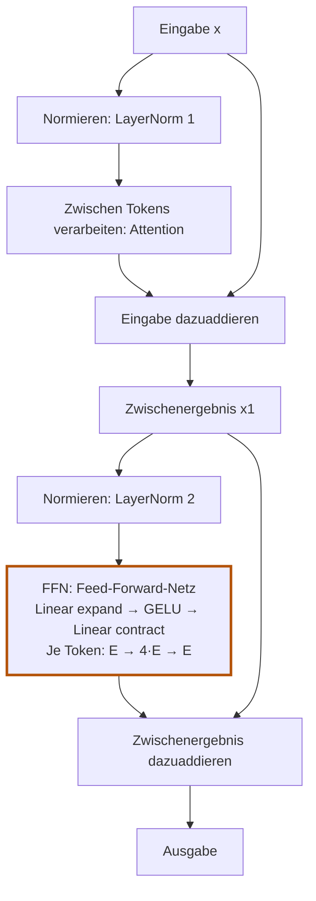

# 6. Der Transformer-Block

## Lernziel und Lernpfad

Kapitel 5 hat Attention fertiggestellt: `MultiHeadAttention` mischt Informationen
aus vorherigen Positionen in jeden Token-Vektor. Die Form bleibt dabei gleich:
`[Fenster, Position, Embedding]` rein, `[Fenster, Position, Embedding]` raus.

Genau das erlaubt es, mehrere solche Bausteine **hintereinander** zu schalten.
Ein GPT-Modell besteht aus vielen gleich gebauten Blöcken. Ein einzelner Block
braucht neben Attention drei weitere Teile:

1. **Feed-Forward-Netz:** verarbeitet jeden Token-Vektor einzeln weiter.
   Attention mischt zwischen Positionen, das Feed-Forward-Netz rechnet
   innerhalb einer Position.
2. **Residual-Verbindung:** addiert die Eingabe zur Ausgabe einer Schicht.
3. **LayerNorm (Layer Normalization):** normiert die Komponenten jedes
   Token-Vektors und passt sie anschliessend mit lernbaren Parametern an.

Zur Orientierung vorab der gesamte Block:

**Das FFN ist der hervorgehobene Knoten in der zweiten Hälfte des Blocks.**
Es erhält das durch LayerNorm 2 normierte Zwischenergebnis `x1` und
verarbeitet jeden Token-Vektor einzeln. Die Erweiterung auf `4·E`, GELU
und die Rückführung auf `E` finden vollständig innerhalb dieses Knotens
statt. Erst danach wird die FFN-Ausgabe zu `x1` addiert; LayerNorm und
Residual-Addition gehören nicht zum FFN selbst.

Beide Hälften folgen demselben Muster: **normieren, verarbeiten,
die jeweilige Eingabe dazuaddieren**. Der direkte Weg zur Addition
heisst Residual-Verbindung (Residual Connection). Zunächst lernen wir
die Teile einzeln kennen; in [6.4](06-04-block-zusammensetzen.md) verfolgen wir ihren Datenfluss zusammen.

## Sechs Lernseiten

| Seite | Die Frage dieser Seite |
|---|---|
| [6.1 LayerNorm verstehen und bauen](06-01-layernorm.md) | Wie normieren wir jeden Token-Vektor und passen ihn lernbar an? |
| [6.2 Feed-Forward-Netz](06-02-feed-forward.md) | Wie wird Kontext innerhalb eines Token-Vektors weiterverarbeitet? |
| [6.3 Residual-Verbindungen](06-03-residual-verbindungen.md) | Warum addieren wir Eingabe und berechnete Änderung? |
| [6.4 Den Transformer-Block zusammensetzen](06-04-block-zusammensetzen.md) | Wie greifen Attention, LayerNorm, FFN und Residual ineinander? |
| [6.5 Den Block in Rust bauen](06-05-block-in-rust.md) | Wo steckt jeder Teil des Diagramms im Code? |
| [6.6 Mehrere Blöcke stapeln](06-06-bloecke-stapeln.md) | Wie wird daraus eine Verarbeitungskette mit eigenen Parametern pro Block? |

Die Modellberechnung steht im Crate `model`. Training, Verlustfunktion und
Optimizer folgen später im Crate `training`. Dieses Kapitel berechnet nur
Vorwärtsdurchläufe und prüft, dass Gradienten fliessen.

**Entscheidung:** Wir verwenden die **Pre-LayerNorm**-Anordnung wie GPT-2:
LayerNorm steht *vor* Attention und Feed-Forward, nicht dahinter. Das
Originalpaper "Attention Is All You Need" setzt LayerNorm dagegen hinter die
Residual-Addition (Post-LayerNorm).

## So lernst du damit

Jede Seite beginnt mit Lernziel und Anschluss an das Bekannte. Lies eine
Seite, versuche die Aufgabe ohne Nachschlagen und öffne erst danach die
Lösung. „Was bleibt?“ fasst den neuen Baustein zusammen. Die Seiten bauen
aufeinander auf; zusätzliche Rust- und Testdetails bleiben aufklappbar.

Zurück: [5.9 Mehrere Köpfe verbinden](05-09-mehrere-koepfe.md).
Start: [6.1 LayerNorm verstehen und bauen](06-01-layernorm.md).
