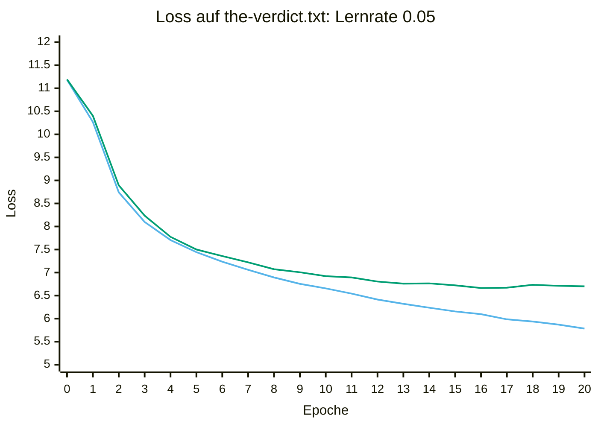

# 13. Auswertung und Overfitting

## Lernziel

Wir wollen wissen: **Welcher Gewichtsstand sagt zurückgehaltenen Text am
besten voraus?** Dazu trainieren wir länger als in Kapitel 12, messen nach
jeder Epoche Trainings- und Validierungs-Loss, berechnen die Perplexity
und speichern nur dann, wenn der Validierungs-Loss besser wird.

Wir bauen auf dem Training mit echtem Text aus Kapitel 12 auf.
Diesmal beobachten wir über mehr Epochen, ob sich die Vorhersagen auch
auf dem zurückgehaltenen Text weiter verbessern. So unterscheiden wir
den letzten Gewichtsstand vom besten.

## 1. Training starten und Ausgabe lesen

Wir erweitern den Versuch von drei auf 20 Epochen. Daten, Modell und
Lernrate bleiben zunächst gleich. So untersuchen wir gezielt, was
längeres Training verändert.

Die Demo für dieses Kapitel startest du mit:

```bash
cargo run --release -p training --example ch13 -- checkpoints/ch13-best.bpk 20
```

In der Ausgabe bedeutet **`PPL` Perplexity**. Hinter `Training` und
`Validierung` steht jeweils zuerst der Loss, danach in Klammern die
zugehörige Perplexity. Für beide Werte gilt: kleiner ist besser.
Für die erste Auswertung genügt der Loss. Den Nutzen und die Berechnung
der Perplexity vertiefen wir in Abschnitt 4.

Erlaubt sind 1 bis 20 Epochen; ohne Argumente meldet das Programm einen
Aufruffehler. Standard ist `data/the-verdict.txt`; ein optionaler dritter
Wert wählt eine andere UTF-8-Textdatei. Die Lernrate ist standardmässig
0,05 und lässt sich mit `--learning-rate` ändern. Der Lauf hat keinen
Zeitabbruch; seine Dauer hängt von Hardware und Build ab.
Jeder Aufruf startet neu, nicht beim bestehenden Checkpoint.

### Loss je Epoche messen

Nach jeder Epoche wird mit festen Gewichten und ohne Updates gemessen:

- **Trainings-Loss** auf allen Trainingsfenstern,
- **Validierungs-Loss** auf allen zurückgehaltenen Fenstern.

Epoche 0 ist die Ausgangsmessung vor dem ersten Update. Die einzelnen
Update-Loss-Werte während des Trainings sind kein Ersatz: Sie stammen aus
verschiedenen Batches und Gewichtsständen.

### Die Ausgabe unseres Echttext-Laufs

Die folgende Ausgabe wurde für dieses Kapitel mit dem enthaltenen Text,
Seed 42, Lernrate 0,05 und 20 Epochen tatsächlich erzeugt. Dateipfade
wurden für das Buch verkürzt; Messwerte sind unverändert.

```text
{{#include ../ausgaben/ch13-20.txt}}
```

Die Markierung `neuer bester Stand` bedeutet: Dieser Gewichtsstand wurde
gespeichert, weil sein Validierungs-Loss bisher am kleinsten ist.
Wie der Code diese Auswahl trifft, sehen wir nach der Auswertung.

## 2. Loss-Kurven und Overfitting

Bis Epoche 13 sinken beide Loss-Werte. Epoche 14 verschlechtert die
Validierung kurz, danach verbessert sie sich wieder bis Epoche 16.
Dieser einzelne Anstieg wäre deshalb noch kein guter Grund, das Training
abzubrechen.

Ab Epoche 17 bleibt der Validierungs-Loss über seinem bisherigen Minimum.
Der Trainings-Loss fällt trotzdem weiter: von 6,0976 in Epoche 16 auf
5,7849 in Epoche 20. Das ist ein Overfitting-Warnsignal:
Das Modell passt sich besser an die Trainingsdaten an, ohne die
zurückgehaltenen Daten besser vorherzusagen.
Der Checkpoint behält **Epoche 16**, obwohl das Training bis 20 läuft.
Die Validierungs-Perplexity ist dort 783,9 statt 814,0 beim letzten Stand.

### Beide Loss-Kurven

Die x-Achse zeigt Epoche 0 bis 20, die y-Achse den Loss.
Die Punkte stammen aus der obigen Ausgabe.

<div role="group" aria-label="Legende der Loss-Kurven">
  <span style="display: inline-block; width: 2em; border-top: 3px solid #56B4E9; vertical-align: middle;" aria-hidden="true"></span>
  Trainings-Loss (hellblau)
  &nbsp;&nbsp;
  <span style="display: inline-block; width: 2em; border-top: 3px solid #009E73; vertical-align: middle;" aria-hidden="true"></span>
  Validierungs-Loss (grün)
</div>



Nach den ersten Epochen ist die Trainingskurve die untere. Ihr Abstand
zur Validierung wächst. Der fallende Trainings-Loss allein hätte uns
also zum falschen letzten Gewichtsstand geführt.

### Das Warnsignal im Code

```rust
{{#include ../../../crates/training/examples/ch13.rs:overfitting_signal}}
```

Das Signal verlangt beides: besserer Trainings-Loss **und** schlechterer
Validierungs-Loss gegenüber dem besten Stand. Ein höherer Validierungs- als
Trainings-Loss allein ist normal und beweist nichts. Auch ein einzelner
Anstieg kann Zufall sein: Der Validierungsbereich dieses Textes umfasst
nur 64 Fenster. Das Programm meldet deshalb ein **Warnsignal**, keinen
Beweis. Ohne Signal ist weder Sprachverständnis noch gute freie
Generierung nachgewiesen.

Das Programm prüft nur den letzten gegen den besten Stand. Ein zeitweise
schlechterer Verlauf mit späterer Erholung kann deshalb am Ende ohne
Warnsignal bleiben. Lies immer auch die einzelnen Epochen.

## 3. Den besten Stand speichern

Der beobachtete Verlauf zeigt, warum wir Epoche 16 behalten wollen.
Kapitel 12 überschreibt den Checkpoint nach jeder Epoche. Das speichert
den **letzten**, nicht den **besten** Stand. Hier gilt die Regel:

```rust
{{#include ../../../crates/training/examples/ch13.rs:best_rule}}
```

Nur bei **strikt kleinerem** Validierungs-Loss wird gespeichert; bei gleichem
oder höherem Wert bleibt der bisherige beste Checkpoint erhalten. Nach dem
Speichern gilt der neue Loss als Massstab. Training läuft trotzdem weiter:
Bestmodell-Auswahl ist kein Trainingsabbruch.

Im echten Lauf verbessert Epoche 16 den Validierungs-Loss von 6,7223 auf
6,6642. Ihre Gewichte werden gespeichert. Epoche 17 erreicht nur 6,6710:
Der Checkpoint wird nicht ersetzt. Auch bis Epoche 20 kommt kein
besserer Stand hinzu.

Auch die Ausgangsmessung in Epoche 0 zählt: Ihre Gewichte werden zuerst
gespeichert. Falls Training die Validierung nur verschlechtert, bleibt
dieser Ausgangsstand erhalten. Ein bereits vorhandener Checkpoint am
gewählten Pfad wird dabei ersetzt; er gehört nicht zum neuen Vergleich.

### Die ergänzte Trainingsschleife

Jetzt können wir Messung und Auswahl in der Schleife nachvollziehen:

```rust
{{#include ../../../crates/training/examples/ch13.rs:training_run}}
```

Gewichte und Optimizer bleiben zwischen den Epochen erhalten; nur die
Reihenfolge der Trainingsfenster wird je Epoche anders gemischt. Die
Zufallsseeds sind festgelegt. `save_if_best` prüft die Auswahlregel,
speichert bei Verbesserung und aktualisiert danach den besten Messwert.

Das Schreiben erfolgt zuerst in eine temporäre Datei, die danach
umbenannt wird; ein vorhandener Checkpoint bleibt so bis zuletzt gültig.
Gespeichert werden nur Modellgewichte, wie in Kapitel 12: kein Optimizer-
Zustand, kein Epochenzähler. Der Checkpoint passt zur festen Konfiguration
dieser Demo (50'257 IDs, Kontext 8, Embedding 8, zwei Köpfe, ein Block) und
lässt sich mit `load_model` und derselben Konfiguration laden.

## 4. Perplexity aus dem Loss

**Für Training, Bestmodell-Auswahl und das Erkennen von Overfitting reicht
der Loss aus.** Perplexity ist dafür nicht nötig. Warum zeigen wir sie
trotzdem? Sie ist eine bei Sprachmodellen übliche Darstellung desselben
Messwerts und macht Verbesserungen als Verhältnis lesbar.

Im ausgewerteten Lauf sinkt die Validierungs-Perplexity von
1809,6 nach fünf Epochen auf 783,9 beim besten Stand. Das Verhältnis
`1809,6 / 783,9` ist ungefähr 2,3: Das Modell weist den richtigen nächsten
Tokens im geometrischen Mittel etwa **2,3-mal so viel Wahrscheinlichkeit**
zu. Das bedeutet **nicht**, dass es 2,3-mal mehr Tokens richtig vorhersagt.

Die Rollen in diesem Kapitel sind also:

- **Loss:** Trainingsverlauf beurteilen und besten Gewichtsstand auswählen.
- **Perplexity (`PPL`):** denselben Fortschritt auf einer anderen Skala
  ausdrücken, keine zusätzliche unabhängige Qualitätsmessung.

### Wie berechnen wir sie?

Unsere Cross-Entropy verwendet den natürlichen Logarithmus. Deshalb gilt:

```text
Perplexity = exp(Loss)
```

In Rust ist das `loss.exp()` für einen `f64`. Loss 0 ergibt Perplexity 1;
Loss 0,7 ungefähr 2,01; Loss 1,4 ungefähr 4,06. **Kleiner ist besser.**

Für jede Zielposition weist das Modell dem richtigen nächsten Token eine
Wahrscheinlichkeit zu. Perplexity ist der Kehrwert des geometrischen
Mittels dieser Wahrscheinlichkeiten. Gibt das Modell an jeder Position
dem richtigen Token 0,5, ist sie genau 2. Allgemein bedeutet Perplexity 2
**nicht**, dass jeweils zwei Tokens gleich wahrscheinlich sind; sie ist
auch keine Fehlerquote.

Weil `exp` streng steigt, wählen Loss und Perplexity denselben besten
Stand. Vergleiche gelten nur bei gleichem Tokenizer und denselben
Auswertungsdaten. Unser Ausgangsmodell liegt bei Loss 11,19
(PPL etwa 72'000), in der Grössenordnung des Vokabulars von 50'257.

## 5. Epochenzahl und Lernrate vergleichen

Zusätzlich wurden zwei Vergleichsläufe durchgeführt. Alle verwenden
denselben Text, Split, Seed, Batch-Grösse und dieselbe Modellkonfiguration.
Nur Epochenzahl beziehungsweise Lernrate ändern sich.

```bash
cargo run --release -p training --example ch13 -- checkpoints/ch13-5.bpk 5
cargo run --release -p training --example ch13 -- checkpoints/ch13-20.bpk 20
cargo run --release -p training --example ch13 -- checkpoints/ch13-lr002.bpk 20 --learning-rate 0.02
```

| Epochen | Lernrate | Beste Epoche | Bester Validierungs-Loss | Beste Validierungs-PPL |
|---|---|---|---|---|
| 5 | 0,05 | 5 | 7,5009 | 1809,6 |
| 20 | 0,05 | 16 | 6,6642 | 783,9 |
| 20 | 0,02 | 20 | 7,0658 | 1171,3 |

**Epochenzahl:** Fünf Epochen waren für diesen Lauf noch zu wenig.
Mehr Training verbessert die Validierung zunächst deutlich, aber
„mehr“ heisst nicht „immer besser“: Das Minimum liegt bei Epoche 16.
Die ersten fünf Epochen der beiden Läufe mit Lernrate 0,05 waren in
diesem Experiment identisch.

**Lernrate:** Mit 0,02 verbessert sich die Validierung bis zur letzten
gemessenen Epoche, erreicht innerhalb von 20 Epochen aber nicht den
Bestwert von 0,05. Das beweist nicht, dass 0,02 grundsätzlich schlechter
ist; die kleinere Schrittweite könnte mehr Updates benötigen.
Lernrate 0,05 ist hier die bessere Wahl für das untersuchte Budget.

Die vollständigen Vergleichsausgaben:

<details>
<summary>5 Epochen, Lernrate 0,05</summary>

```text
{{#include ../ausgaben/ch13-5.txt}}
```

</details>

<details>
<summary>20 Epochen, Lernrate 0,02</summary>

```text
{{#include ../ausgaben/ch13-20-lr002.txt}}
```

</details>

Verwende für eigene Versuche unterschiedliche Checkpoint-Pfade.
Beurteile jeweils den besten Validierungsstand, nicht nur den letzten
Trainings-Loss. Die Kurven im Buch dokumentieren dieses Experiment;
ein neuer Aufruf aktualisiert sie nicht automatisch.

## 6. Den besten Stand laden und Text erzeugen

Nach dem Trainingsaufruf aus Abschnitt 1 enthält
`checkpoints/ch13-best.bpk` den besten gemessenen Stand dieses Laufs.
Verwende ihn jetzt für eine Fortsetzung:

```bash
cargo run --release -p training --example ch12_full -- generate checkpoints/ch13-best.bpk "I HAD always" 16
```

`ch12_full` ist hier kein erneutes Training: Der Unterbefehl `generate`
lädt die gespeicherten Gewichte mit `load_model`, tokenisiert den Starttext
und erzeugt mit `argmax` 16 zusätzliche Tokens. Anschliessend decodiert
derselbe GPT-2-Tokenizer Starttext und Fortsetzung. Die Wiederverwendung
funktioniert, weil Kapitel 12 und 13 dieselbe Modellkonfiguration und
Token-Zuordnung verwenden.

Der Pfad muss zu deinem Trainingsaufruf passen. Hast du beispielsweise
`checkpoints/ch13-20.bpk` gewählt, verwende diesen Pfad auch beim Laden.
Ohne zuvor erfolgreich gespeicherte Gewichte schlägt der Aufruf fehl;
er ersetzt sie nicht durch ein Zufallsmodell.

Mit dem besten Checkpoint des hier dokumentierten 20-Epochen-Laufs
(Epoche 16, Lernrate 0,05) ergab der Aufruf:

```text
Token-IDs (Starttext + Fortsetzung): [40, 367, 2885, 1464, 13, 198, 198, 1, 1, 40, 284, 438, 284, 314, 284, 314, 284, 314, 284, 314]
Text (keine Qualitätsgarantie):
I HAD always.

""I to-- to I to I to I to I
```

Die Wiederholungen zeigen die Grenze unseres Versuchs: Der beste
Validierungs-Loss unter den gemessenen Ständen garantiert keine gute
freie Fortsetzung. Bei der Validierung erhält das Modell echte
Textfenster; beim Generieren verarbeitet es zunehmend seine eigenen
Vorhersagen. Sein Kontext umfasst weiterhin nur acht Tokens.

Der geladene Checkpoint ist der beste, nicht der letzte Stand: Nach
20 Epochen wird hier mit den Gewichten aus Epoche 16 generiert.
Die Epochenzahl steht allerdings nicht in der Gewichtsdatei; ihre
Zuordnung kennen wir aus der Trainingsausgabe. Der Aufruf setzt das
Training nicht fort und verändert den Checkpoint nicht.

## 7. Was wir daraus mitnehmen

Wir können jetzt Trainingsfortschritt und Generalisierung unterscheiden,
Loss als Perplexity ausdrücken und den besten statt bloss den letzten
Gewichtsstand behalten. Drei Epochen waren keine optimale Grenze;
auch 20 sind nur ein bewusst begrenztes Experiment.

Unser Validierungsbereich stammt aus derselben kurzen Geschichte.
Er ist kein unabhängiger Test für allgemeine Sprachqualität. Je öfter
wir Lernrate und Epochenzahl anhand dieser Daten auswählen, desto
weniger unabhängig ist ihre Bewertung. Für eine abschliessende Messung
bräuchten wir zusätzliche, bei der Auswahl unbenutzte Testdaten.

Mehr Epochen ersetzen weder vielfältige Daten noch eine geeignete
Modellgrösse. Ein besserer Validierungs-Loss garantiert zudem keine
sinnvolle freie Textgenerierung.

Kapitel 14 untersucht bessere Optimierung, etwa Adam und
Lernratenänderungen. Die Auswertung aus diesem Kapitel bleibt dabei
der Massstab: Neue Optimierung muss sich auf zurückgehaltenen Daten
bewähren, nicht bloss den Trainings-Loss schneller senken.

## Prüfen

```bash
cargo test -p training --example ch13
```

Die Tests prüfen die Perplexity-Formel, die strikte Bestmodell-Regel, die
Bedingungen des Overfitting-Signals, die Epochengrenze und einen kurzen
Lauf auf einem Testtext: Der geladene Checkpoint hat den besten
Validierungs-Loss. Der lange Lauf auf `data/the-verdict.txt` gehört nicht
zu den Tests.
